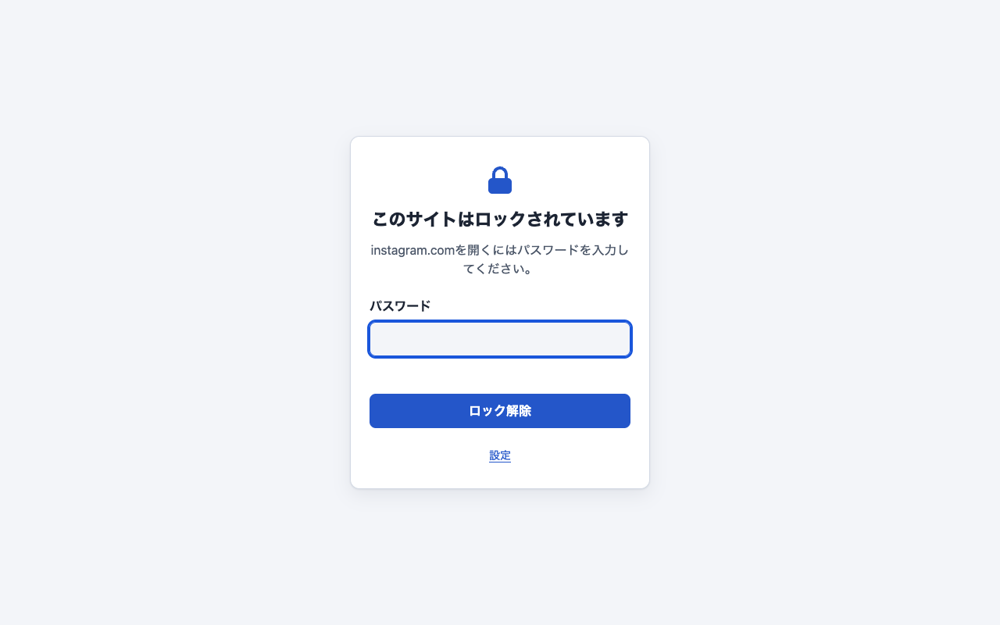
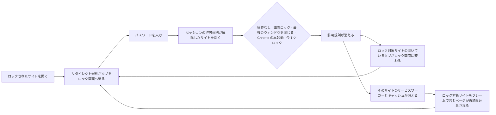

<div align="center">


[English](README.md) · [한국어](README.ko.md) · **日本語**

[](LICENSE)
[](CHANGELOG.md)
[](CHANGELOG.md)
[](https://developer.chrome.com/docs/extensions/develop/migrate/what-is-mv3)
[](#インストール)

**選んだサイトにパスワードをかけ、席を離れたらまたロックします。**

 

</div>

> **状況：開発中、バージョン 0.1.0 の下書きです。** まだリリースはなく、Chrome ウェブストアにも公開していません。今は[ソースからインストール](#インストール)してください。

**はじめての方は[使い方ガイド](docs/usage.ja.md)をどうぞ。** インストール、最初の起動、ロックと解除、設定、トラブル対応を、スクリーンショット付きで説明します。

## 機能

- **サイト全体をロックします。** `instagram.com` や完全なアドレスを貼り付けると、そのサイトと、その下にあるすべてのアドレスが、深さに関係なくロックされます（`www.instagram.com`、`help.instagram.com`、`a.b.instagram.com`）。サイトは常に丸ごとロックされます。1ページやサブドメイン1つへのリンクを入れても、登録可能なドメイン全体がロックされます。Naver のブログのアドレスなら `naver.com` 全体が、Gmail のアドレスなら検索を含む `google.com` 全体がロックされます。サブドメイン1つだけを単独でロックすることはできません。`user.github.io` のように、みんなで共有しているアドレスは、それぞれ別のサイトとして扱います。`notinstagram.com` のように名前が似ているだけのサイトには手を出しません。
- **まずロック画面。** ロックされたサイトでは、ページの代わりにロック画面が表示されます。リンク、ブックマーク、アドレスバー、手で入力したアドレスのどれでも同じです。ロック画面にはサイトの名前だけが表示され、開こうとしたページのアドレスは表示されません。アドレスバーにも、ページのアドレスの代わりにランダムなコードが入ります。
- **パスワードは1つ。** ロックされたサイトと設定画面を同じパスワードで開きますが、解除する場所は別々です。ロック画面ではサイトが開き、設定では、もう一度パスワードを聞かれます。パスワードは salt 付きの PBKDF2-SHA256 ハッシュとしてのみ保存され、元に戻すことはできません。
- **1回の解除の範囲を選べます。** 初期設定では、ロックしたサイトがすべていっしょに開きます。セキュリティの設定で、解除したサイトだけが開くように変えられます。
- **自動でまたロックします。** キーボードやマウスの操作が数分間ないとき、画面がロックされたとき、最後の Chrome ウィンドウを閉じたとき、Chrome を起動し直したときです。
- **クイックロック。** ツールバーのボタン（**今すぐロック**）とショートカットキー Alt+Shift+L で、パスワードなしでまとめてロックできます。
- **開いているタブもロックします。** 再ロックのとき、ロック対象サイトのタブはロック画面に切り替わり、「戻る」を押しても元のページは表示されません。ほかのページに埋め込まれたロック対象サイトはブロックされ、ロック対象サイトを埋め込んだページは、再ロックのときに再読み込みされます。ロック対象サイトが開いた `blob:` ページや空の `about:blank` タブも、いっしょにロックされます。Chrome の再起動や拡張機能の更新のあとに Chrome が復元したロック画面も、自分のサイトを覚えています。
- **保存されたコピーを消します。** 再ロックのたびに、サイト自身のサービスワーカーとキャッシュを消すので、サイトが保存済みのコピーで代わりに応答することはできません。Cookie とログインには手をつけません。
- **総当たり対策。** ロック画面に、残りの試行回数が表示されます。5回間違えると、30秒から始まり、試すたびに2倍になる待ち時間が入り、最大15分です。残り時間はカウントダウンで表示されます。
- **初回のセットアップは4ステップ。** ようこそ、パスワード、ロックするサイトの選択（よく使うサイトはワンタップ）、自動ロックです。パスワードを忘れたときの案内は、ロック画面にあります。
- **プライバシー重視。** ネットワーク通信も、分析ツールも、アカウントもありません。すべてあなたのパソコンの中だけにあります。
- **少ない権限。** サイトへのアクセスは、サイトを追加するときに1サイトずつ求めます。
- **日本語・英語・韓国語**の画面に対応しています。

想定している状況は、**席を離れている間に、ログイン済みのあなたの Chrome の前に別の人が座ること**です。パソコンそのものを自由に操作できる人を防ぐものではありません（[防げないこと](#何を守り何を守れないか)を参照）。

## 仕組み



<details>
<summary>図の裏にある規則</summary>

- ロックされたサイトは、Chrome 標準の `declarativeNetRequest` の規則でブロックします。ページのリクエストを拡張機能のロック画面へ送るリダイレクト規則があり、同じドメインに、優先度のより低いブロック規則がもう1つあります。ブロック規則はあらゆる種類のリクエストを止めます。ツールバーのメニューでサイトへのアクセス権を外しても動き続けるので、サイトの中身ではなくブロック画面が表示されます。ほかのページに埋め込まれたロック対象サイトや、保存済みのコピーが送るリクエストも止めます。
- パスワードが合っていると、優先度のより高い許可規則を1つ追加します。この規則はブラウザのセッションの間だけ存在し、「ロック解除中」の状態はこの規則だけです。規則には、セキュリティの設定**サイトのロックを解除するとき**に応じて、ロック対象のサイトすべて、または解除したサイトだけが入ります。この設定を変えると規則が消えて、サイトはもう一度ロックされます（設定画面は開いたままです）。Chrome を再起動すると規則が消えるので、ロックされた状態で始まります。
- 操作なしの検出には Chrome の `idle` API を使い、Chrome の中だけでなく、パソコン全体のキーボードとマウスの操作を数えます。
- 再ロックでは、許可規則を消し、ロック対象サイトを開いているタブごとに、同じウィンドウの同じ位置にロック画面の新しいタブを作ります。古いタブのアドレスだけを変えると、「戻る」で Chrome のキャッシュから元のページが復活してしまうため、新しいタブを使います。同じ理由で、ロック対象サイトを表示したあと別のサイトに移ったタブも、同じアドレスの新しいタブで開き直し、そのタブの履歴は残しません。ロックを解除すると、その解除で開いたサイトのロック画面は、すべて元のサイトに戻ります。設定画面も、あわせてロックし直されます。ロック対象サイトを表示したタブが開いた `blob:` ページや、空の `about:blank`・`about:srcdoc` タブも置き換えます（そのサイトの内容が入っている可能性があるためです）。
- サイト自身のサービスワーカーは、リクエストが Chrome の規則に届かなくてもページを代わりに表示できるため、規則だけでは見逃すことがあります。そのため、再ロックのたび、Chrome の起動のたび、サイトを新しくロックするたびに、ロック対象サイトのサービスワーカーとキャッシュストレージを消します（`browsingData` 権限です。Chrome はこの権限に警告を表示しません）。Cookie、ログイン、そのほかのサイトのデータはそのままです。消す範囲は、サイト自身のアドレス、`www.` と `m.` のアドレス、そしてタブやフレームが表示したことのあるその下のアドレスです。そのために、拡張機能はそれらのアドレスをローカルストレージに保存します。
- `webNavigation` 権限によって、拡張機能はフレームを見ることができます。再ロックのとき、その時点でロック対象サイトをフレームで表示しているタブだけが、履歴を保ったまま再読み込みされます。そのタブ自身の「サイトを離れますか？」やフォーム再送信の確認が再読み込みを止めた場合は、約3秒後にタブを閉じて同じアドレスで開き直し、保存していない入力は失われます。ロック中にフレームがまた現れた場合も同じように処理し、もう一度現れると、そのタブにロック画面を表示します。
- `tabs` 権限によって、それでも読み込まれたロック対象サイトのページ（たとえばサービスワーカーが代わりに表示したページや、アクセス権が外されたサイトのページ）に気づきます。そのタブはロック画面に置き換えられます。その前に、元のページや Chrome のブロック画面が一瞬表示されることがあります。
- ロック画面が受け取るのはランダムなコードだけです。開こうとしたページのアドレスは、ロックを解除するかタブを閉じるまで、そのタブに結び付けられています。拡張機能のセッションメモリにあり、再ロックのときに拡張機能が自分で開いたロック画面のタブの分は `chrome.storage.local` にもあるので、Chrome の再起動や拡張機能の更新のあとも、そのタブは自分のサイトを覚えています。保存されたアドレスは、タブがなくなると消えます（遅くとも次のロックのとき）。

</details>

## インストール

> **まだ Chrome ウェブストアにはありません。** 開発中の下書き（0.1.0）でリリースがないため、ソースから拡張機能をビルドし、できたフォルダーを Chrome に読み込みます。5分ほどかかります。[使い方ガイド](docs/usage.ja.md#インストール)に、同じ手順と macOS・Windows の補足があります。

[Git](https://git-scm.com/)、[Node.js](https://nodejs.org/) 22 以上、Chrome 120 以上が必要です。

1. コードを取得してビルドします。

   ```sh
   git clone https://github.com/xcryptp/for-my-privacy.git
   cd for-my-privacy
   npm ci
   npm run build
   ```

   `.output/chrome-mv3` フォルダーができます。（`npm run build:noguard` は、拡張機能ページの保護だけを除いた同じ拡張機能を `.output/chrome-mv3-noguard` に作ります。）
2. Chrome で `chrome://extensions` を開きます。
3. 右上の**デベロッパー モード**をオンにします。
4. **パッケージ化されていない拡張機能を読み込む**を押し、`.output/chrome-mv3` フォルダー（`manifest.json` が入っているフォルダー）を選びます。macOS では、フォルダーを選ぶ画面で Command+Shift+. を押すと、名前がドットで始まるフォルダーが表示されます。
5. 設定画面が開き、短いセットアップが始まります（[使い方](#使い方)を参照）。

フォルダーはそのまま置いておいてください。Chrome は起動のたびにこのフォルダーから拡張機能を読み込むので、後で削除したり移動したりしないでください。この方法で入れた拡張機能があると、Chrome の起動時にデベロッパーモードの拡張機能についてのお知らせが出ますが、正常です。Chrome ウェブストアへの公開は、あとで行うかもしれません。まだありません。

Chrome は、拡張機能の権限を表示する場所（ストアのページ、拡張機能の詳細）で、警告を2つ表示します。`declarativeNetRequest` 権限は「**あらゆるページのコンテンツをブロック**」と表示されます。サイトへのアクセス権が外されてもロック対象サイトをブロックし続けるために、この権限が必要です。動作するのは、あなたが追加したサイトだけです。`tabs` と `webNavigation` は、閲覧履歴を読み取るという1つの警告（「**Read your browsing history**」）を共有します。ロック対象サイトを表示しているタブやフレームを見つけるために必要です。拡張機能はそれらのアドレスをロックするサイトの一覧と照らし合わせるだけで、どこにも送りません。残りの権限 `storage`、`idle`、`browsingData` には、Chrome は警告を表示しません。サイトへのアクセスは任意で、サイトを追加するときに1サイトずつ求めます。

## 使い方

スクリーンショット付きの手順は[使い方ガイド](docs/usage.ja.md)にあります。

1. **セットアップ。** 拡張機能を読み込むと、設定画面が開き、4つのステップが始まります。**始める**を押します。パスワードを作ります（復元できないという警告が表示されます）。**ロックするサイトを選ぶ**で、ロックしたいサイト（instagram.com、facebook.com、x.com、tiktok.com、youtube.com）を押すか、**ほかのサイト**に入力してから**次へ**を押します（何も選ばない場合は**スキップ**）。Chrome が、選んだサイトへのアクセス許可を求めるので、許可します。最後に**自動でもう一度ロック**の内容を決めて**完了**を押します。選んだサイトはすぐにロックされます。作ったばかりのパスワードでサイトが開くことはありません。
2. **あとからサイトを追加・削除します。** 設定を開きます（ロック画面の**設定**を押す、ツールバーのポップアップの**設定を開く**を押す、または拡張機能のアイコンを右クリックして**オプション**を選びます）。設定は**サイト**で開きます。**ロックするサイト**の下に、サイトを入力するか完全なアドレスを貼り付けて**追加**を押します。入力欄の下の1行が、何がロックされるかを教えてくれます。たとえば Naver のブログのアドレスなら、`naver.com` 全体がロックされると表示されます。Chrome がそのサイトへのアクセス許可を求めるので、許可します。**削除**を押すと、一覧から外れます。
3. **ロックされたサイトを開きます。** ロック画面が表示されます。パスワードを入力して**ロック解除**を押すと、サイトが開きます。ロック画面には、待ち時間が入るまでの残りの試行回数と、ボタンの下に、この解除で何が開くかが表示されます。
4. **自分でロックします。** ツールバーの拡張機能のアイコンを押し（見えない場合は、パズルのピースのメニューから先に固定してください）、**今すぐロック**を押すか、ショートカット（初期設定は Alt+Shift+L、macOS では Option+Shift+L と表示されます）を押します。どちらもパスワードは聞かれません。ほかの拡張機能がすでに同じショートカットを使っていると、Chrome がショートカットを空けたままにすることがあります。ポップアップには今設定されているキーが表示され、`chrome://extensions/shortcuts` で変更できます。設定画面の上にある**今すぐロック**も同じ働きです。
5. **再ロックの条件を選びます。** **自動ロック**で、**キーボードもマウスも使わない時間（分）**（1〜60、初期値は5）を決め、**画面がロックされたら、サイトもロックする**をオン・オフします。
6. **1回の解除の範囲を選びます。** **セキュリティ**の**サイトのロックを解除するとき**には、2つの選択肢があります。**ロックしたサイトをすべていっしょに解除する**（初期設定：1回解除すると、ロックしたサイトすべてと Chrome の拡張機能ページが開きます）と、**そのサイトだけ解除する**（ロック画面に表示されたサイトと、その下にあるすべてのアドレスだけが開きます。Chrome の拡張機能ページは、そのページのロック画面で解除したときだけ開きます）です。この設定を変えると、サイトはすぐにもう一度ロックされます。設定画面は開いたままです。
7. **拡張機能ページを守ります。** これも**セキュリティ**で、**Chromeの拡張機能ページを開く前にパスワードを求める**をオン・オフします。このスイッチは `-noguard` ビルドにはありません。

設定も同じパスワードで開きますが、サイトとは別です。サイトを解除しても設定は開かず、設定を開いてもサイトは開きません。**パスワードを変更**も**セキュリティ**にあります。

パスワードを忘れると、復元はできません。ロック画面と、ロックされた設定画面には、**パスワードを忘れた場合**の案内があり、最初からやり直す方法が書かれています。Chrome のツールバーでパズルのピースのアイコンをクリックし、For My Privacy の横にある三点メニューから「Chrome から削除」を選び、拡張機能をもう一度インストールします。パスワードとサイトの一覧が消えます。

## 何を守り何を守れないか

For My Privacy は、ログイン済みのあなたの Chrome を使う人が、ロックしたサイトを開くのを防ぎます。ほかのページに埋め込まれたロック対象サイトもブロックし、サイト自身のサービスワーカーが代わりに応答することもできません。次のことは防げ**ません**。

| 項目 | 理由 | 役に立つもの |
| --- | --- | --- |
| ツールバーのメニューからの拡張機能の削除 | Chrome では誰でも拡張機能を削除できます | [Chrome のポリシー](#chrome-のポリシーでさらに強くする) |
| 拡張機能をオフにした Chrome の起動（`--disable-extensions` のような起動オプション）、プロファイルファイルの書き換え | 拡張機能の外で起きることです | [Chrome のポリシー](#chrome-のポリシーでさらに強くする) |
| Chrome の**設定のリセット**（`chrome://settings/reset`） | この拡張機能を含め、すべての拡張機能をオフにします | [Chrome のポリシー](#chrome-のポリシーでさらに強くする) |
| Chrome のデベロッパーツール | デベロッパーツールを使いこなす人まで防げるとは約束しません | [Chrome のポリシー](#chrome-のポリシーでさらに強くする) |
| 履歴、アドレスバーの候補、タブ検索に残るページのタイトル | Chrome が保存しています | 0.1.0 にはありません |
| メッセージのプレビューなどのサイト通知 | サイトを解除している間は、サイトが通知を出し続けることがあります。ロックのたびにサイトのサービスワーカーを消すので、ウェブプッシュ通知は、解除してサイトをもう一度開くまで止まります | 0.1.0 にはありません |
| ウェブサイトに、この拡張機能が入っていることが分かること | ロック画面はウェブから参照できるページなので、どのウェブサイトでも For My Privacy が入っていることは調べられます（何をロックしたかは分かりません） | 0.1.0 にはありません |
| 保存済みのページが一瞬見えること | サイトのサービスワーカーを間に合うように消せないと、ロック画面に置き換わる前に、保存済みのページが一瞬表示されることがあります。アクセス権が外されたサイトでは、Chrome のブロック画面が先に表示されることがあります | サイトへのアクセスを許可したままにしてください。外れると、設定に**アクセスを許可**ボタンが表示されます |
| Chrome の起動時に復元されるタブ | 復元されたタブは、拡張機能がロック画面に置き換えるまでの間、サイトの保存済みのページが一瞬見えることがあります | 0.1.0 にはありません |
| シークレットウィンドウとゲストウィンドウ | あなたのログインがなく、拡張機能も初期設定でオフです | 想定している状況ではありません |

パソコンの管理者なら、拡張機能やポリシーがしたことを元に戻せます。管理者パスワードを別の人が持っているときが、いちばん強い設定です。

## Chrome のポリシーでさらに強くする

<details>
<summary>任意：デベロッパーツールをオフにし、拡張機能を削除できなくする</summary>

Chrome には公式の管理ポリシーがあります。そのうち2つが、上の大きな穴をふさぎます。

| ポリシー | 値 | 働き |
| --- | --- | --- |
| `DeveloperToolsAvailability` | `2` | Chrome のデベロッパーツールをどこでもオフにします |
| `ExtensionInstallForcelist` | `<EXTENSION_ID>;https://clients2.google.com/service/update2/crx` | Chrome ウェブストアから拡張機能をインストールして維持します。ツールバーのメニューからオフにしたり削除したりできなくなります |

> **警告：まだ確認できていません。** `DeveloperToolsAvailability = 2` は、`chrome://extensions` のデベロッパーモードまでオフにしてしまうかもしれません（Chrome の `ExtensionDeveloperModeSettings` ポリシーが未設定のとき、この値に従う可能性がありますが、確認できていません）。そうなると、パッケージ化されていない拡張機能（[インストール](#インストール)を参照）は再読み込みも更新もできなくなり、Chrome が無効にしてしまうかもしれません。**これらのポリシーは、主にストアからインストールした場合のためのものです。** zip を手動で入れた場合は、更新する前にポリシーを削除してください。パッケージ化されていないインストールと、デベロッパーツールだけをオフにするポリシーの組み合わせは、まだ試していません。[`docs/manual-checks.md`](docs/manual-checks.md) の15番の項目です。

すぐ使えるファイルです。

- macOS：[`docs/hardening/macos/for-my-privacy-chrome.mobileconfig`](docs/hardening/macos/for-my-privacy-chrome.mobileconfig)（構成プロファイル、ペイロードタイプ `com.google.Chrome`）
- Windows：[`docs/hardening/windows/for-my-privacy-chrome.reg`](docs/hardening/windows/for-my-privacy-chrome.reg)（`HKLM\SOFTWARE\Policies\Google\Chrome` と `...\ExtensionInstallForcelist` の下のレジストリキー）

強制インストールのポリシーには、拡張機能の Chrome ウェブストアの ID が必要です。ストアに公開されてから手に入ります。ファイルの `<EXTENSION_ID>`（山かっこを含む）を32文字の ID に置き換えてください。ストアに公開されるまでは、強制インストールの部分を削除してください。ストア版と、パッケージ化されていない状態で入れた版は、保存場所もパスワードも別の、別々の拡張機能です。ストア版を強制インストールする前に、パッケージ化されていない版を削除してください。デベロッパーツールのポリシーだけを使う前に、上の警告を読んでください。

**macOS**

1. `.mobileconfig` ファイルをテキストエディタで開き、`&lt;EXTENSION_ID&gt;` を32文字の ID に置き換えます（ファイルは XML なので、山かっこは `&lt;` と `&gt;` と書かれています）。
2. ファイルをダブルクリックします。プロファイルがダウンロードされたと表示されます。
3. システム設定で**プロファイル**を探し（プライバシーとセキュリティの中、新しい macOS では一般のデバイス管理）、プロファイルを選んで**インストール**を押します。管理者パスワードを入力します。
4. Chrome を再起動して `chrome://policy` を開き、**ポリシーを再読み込み**を押します。2つのポリシーが表示されるはずです。
5. 元に戻すには、同じプロファイル画面でプロファイルを削除します。

**Windows**

1. `.reg` ファイルを右クリックして**編集**を選ぶか（Windows 11 では**その他のオプションを表示**の中にあります）、メモ帳で開き、`<EXTENSION_ID>`（山かっこを含む）を ID に置き換えます。
2. ファイルをダブルクリックし、管理者の確認に同意します。
3. Chrome を再起動して `chrome://policy` を開き、**ポリシーを再読み込み**を押します。2つのポリシーが表示されるはずです。
4. 元に戻すには、レジストリエディタで `HKLM\SOFTWARE\Policies\Google\Chrome` の `DeveloperToolsAvailability` の値と `ExtensionInstallForcelist` のキーを削除します。

これらのポリシーは Chrome の本物の管理機能です。パソコンの管理者ならこれも削除できるので、管理者パスワードを別の人が持っているときが、いちばん強い設定です。

</details>

## プライバシー

パソコンの外に出るものはありません。パスワードのハッシュ、サイトの一覧、設定、間違えた回数と待ち時間、タブが表示したロック対象サイトのサブドメインのアドレス（保存済みのサービスワーカーとキャッシュを消すために保存）、拡張機能が開いたロック画面が解除後に開くページのアドレス（Chrome の再起動や更新のあとでもロック画面が続くように保存し、ロック画面を閉じると削除）は `chrome.storage.local` に保存され、ネットワーク通信も分析ツールもありません。詳しくは、英語・韓国語・日本語で [PRIVACY.md](PRIVACY.md) に書いてあります。

## 開発

Node 22 以上が必要です（CI は Node 24 を使います）。

<details>
<summary>スクリプトとビルドの試し方</summary>

```sh
npm ci                  # インストール
npm run dev             # 編集しながらビルドして再読み込み
npm run build           # .output/chrome-mv3 に本番用ビルド
npm run build:noguard   # 同じビルドから拡張機能ページの保護だけを除く
npm test                # 単体テスト (Vitest)
npm run test:e2e        # e2e モードをビルドしてブラウザテストを実行 (Playwright)
npm run zip             # ストア用 zip。noguard の zip は npm run zip:noguard
```

ブラウザテストを初めて実行するときは Chromium が必要です：`npx playwright install chromium`。

ビルドを試すには、[インストール](#インストール)と同じように `.output/chrome-mv3` を**パッケージ化されていない拡張機能を読み込む**で読み込みます。この README のスクリーンショットは、`npm run build` の後に `node scripts/screenshots.ts` で、[使い方ガイド](docs/usage.ja.md)のスクリーンショットは `node scripts/usage-screenshots.ts` で作ります（`.ts` ファイルを直接実行するため、Node 22.18 以上または 23.6 以上が必要です）。自動化できない手作業の確認一覧は [`docs/manual-checks.md`](docs/manual-checks.md) にあります。ビルドに含まれる外部コードの断片のライセンスは [THIRD_PARTY_LICENSES](THIRD_PARTY_LICENSES) にあります。

</details>

## リリース

[RELEASING.md](RELEASING.md) を見てください。バージョンを上げ、[CHANGELOG.md](CHANGELOG.md) を更新し、タグを付けると、リリースのワークフローが zip を作ります。

## ライセンス

[MIT](LICENSE) © 2026 xcryptp
