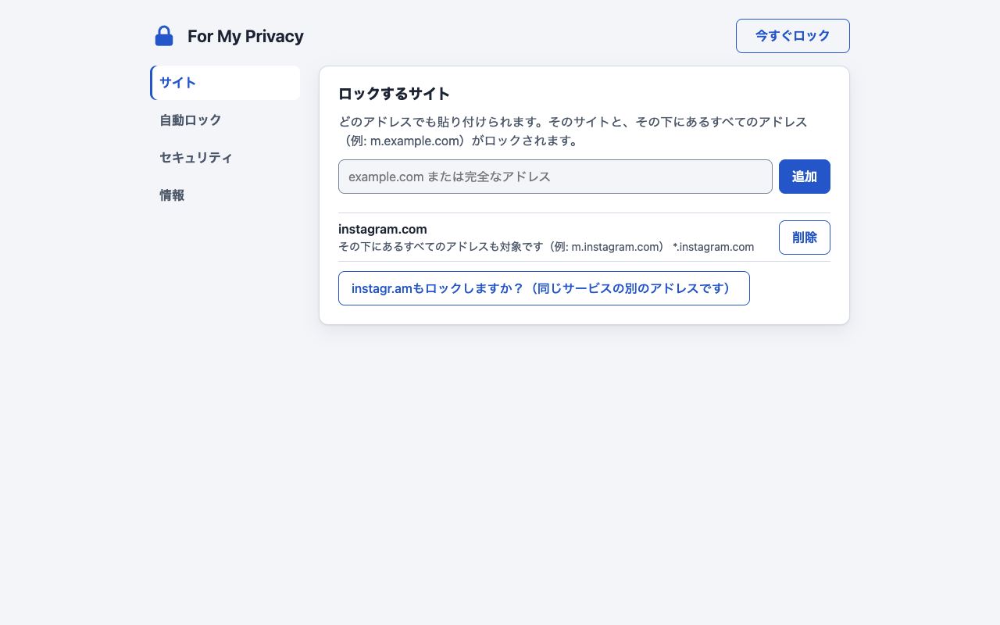
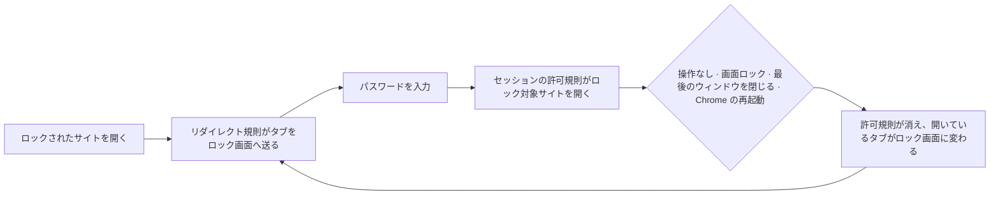

<div align="center">


[English](README.md) · [한국어](README.ko.md) · **日本語**

[](LICENSE)
[](CHANGELOG.md)
[](https://developer.chrome.com/docs/extensions/develop/migrate/what-is-mv3)
[](#インストール)

**選んだサイトにパスワードをかけ、席を離れたらまたロックします。**

 

</div>

## 機能

- **サイト全体をロックします。** `instagram.com` を追加すると、サブドメインもすべてロックされます（`www.instagram.com`、`help.instagram.com`）。`notinstagram.com` のように名前が似ているだけのサイトには手を出しません。
- **まずロック画面。** ロックされたサイトでは、ページの代わりにロック画面が表示されます。リンク、ブックマーク、アドレスバー、手で入力したアドレスのどれでも同じです。
- **パスワードは1つ。** ロックされたすべてのサイトと設定画面が、同じパスワードで開きます。パスワードは salt 付きの PBKDF2-SHA256 ハッシュとしてのみ保存され、元に戻すことはできません。
- **自動でまたロックします。** キーボードやマウスの操作が数分間ないとき、画面がロックされたとき、最後の Chrome ウィンドウを閉じたとき、Chrome を起動し直したときです。
- **開いているタブもロックします。** 再ロックのとき、ロック対象サイトのタブはロック画面に切り替わり、「戻る」を押しても元のページは表示されません。
- **総当たり対策。** 5回間違えると、その後は試すたびに待ち時間が長くなり、最大15分になります。
- **プライバシー重視。** ネットワーク通信も、分析ツールも、アカウントもありません。すべてあなたのパソコンの中だけにあります。
- **少ない権限。** サイトへのアクセスは、サイトを追加するときに1サイトずつ求めます。
- **日本語・英語・韓国語**の画面に対応しています。

想定している状況は、**席を離れている間に、ログイン済みのあなたの Chrome の前に別の人が座ること**です。パソコンそのものを自由に操作できる人を防ぐものではありません（[防げないこと](#何を守り何を守れないか)を参照）。

## 仕組み



<details>
<summary>図の裏にある規則</summary>

- ロックされたサイトは、Chrome 標準の `declarativeNetRequest` の規則でブロックします。ページのリクエストを拡張機能のロック画面へ送るリダイレクト規則があり、同じドメインに、優先度のより低いブロック規則がもう1つあります。ツールバーのメニューでサイトへのアクセス権を外しても、ブロック規則は動き続けるので、サイトの中身ではなくブロック画面が表示されます。
- パスワードが合っていると、優先度のより高い許可規則を1つ追加します。この規則はブラウザのセッションの間だけ存在し、「ロック解除中」の状態はこの規則だけです。Chrome を再起動すると規則が消えるので、ロックされた状態で始まります。
- 操作なしの検出には Chrome の `idle` API を使い、Chrome の中だけでなく、パソコン全体のキーボードとマウスの操作を数えます。
- 再ロックでは、許可規則を消し、ロック対象サイトを開いているタブごとに、同じウィンドウの同じ位置にロック画面の新しいタブを作ります。古いタブのアドレスだけを変えると、「戻る」で Chrome のキャッシュから元のページが復活してしまうため、新しいタブを使います。
- 他のサイトに埋め込まれた（iframe の）ロック対象サイトは、ロック画面へは送らず、ブロックするだけです。

</details>

## インストール

> **Chrome ウェブストア：準備中です。** それまでは、リリースの zip ファイルを手動でインストールしてください。1分ほどです。この方法で入れた拡張機能があると、Chrome の起動時にデベロッパーモードの拡張機能についてのお知らせが出ますが、正常です。

1. [Releases](https://github.com/xcryptp/for-my-privacy/releases) から `for-my-privacy-0.1.0-chrome.zip` をダウンロードします。（`-noguard` の zip は、拡張機能ページの保護だけを除いた同じ拡張機能です。）
2. 解凍します。
   - macOS：Finder で zip ファイルをダブルクリックします。
   - Windows：zip ファイルを右クリックして**すべて展開**を選び、**展開**を押します。
3. 解凍したフォルダを、ずっと置いておける場所（たとえばドキュメントフォルダ）に移します。Chrome は起動のたびにこのフォルダから拡張機能を読み込むので、後で削除したり移動したりしないでください。
4. Chrome で `chrome://extensions` を開きます。
5. 右上の**デベロッパー モード**をオンにします。
6. **パッケージ化されていない拡張機能を読み込む**を押し、`manifest.json` が入っているフォルダを選びます。
7. 設定画面が開くので、パスワードを作ります。

Chrome は、拡張機能の権限を表示する場所（ストアのページ、拡張機能の詳細）で、`declarativeNetRequest` 権限を「**あらゆるページのコンテンツをブロック**」と表示します。サイトへのアクセス権が外されてもロック対象サイトをブロックし続けるために、この権限が必要です。動作するのは、あなたが追加したサイトだけです。

## 使い方

1. **サイトを追加します。** 設定を開きます（ロック画面の**設定**を押すか、拡張機能のアイコンを右クリックして**オプション**を選びます）。**ロックするサイト**の下に `instagram.com` のようなサイトを入力して**追加**を押します。Chrome がそのサイト1つへのアクセス許可を求めるので、許可します。
2. **サイトを開きます。** ロック画面が表示されます。パスワードを入力して**ロック解除**を押すと、サイトが開きます。
3. **自分でロックします。** 設定画面の上にある**今すぐロック**を押します。
4. **再ロックの条件を選びます。** **自動でもう一度ロック**の下で、**キーボードもマウスも使わない時間（分）**（1〜60、初期値は5）を決め、**画面がロックされたら、サイトもロックする**と**Chromeの拡張機能ページを開く前にパスワードを求める**をオン・オフします。2つ目のスイッチは `-noguard` ビルドにはありません。

パスワードを忘れたら、拡張機能を削除して入れ直してください。パスワードとサイトの一覧が消えます。

## 何を守り何を守れないか

For My Privacy は、ログイン済みのあなたの Chrome を使う人が、ロックしたサイトを開くのを防ぎます。次のことは防げ**ません**。

| 項目 | 理由 | 役に立つもの |
| --- | --- | --- |
| ツールバーのメニューからの拡張機能の削除 | Chrome では誰でも拡張機能を削除できます | [Chrome のポリシー](#chrome-のポリシーでさらに強くする) |
| 拡張機能をオフにした Chrome の起動、プロファイルファイルの書き換え | 拡張機能の外で起きることです | [Chrome のポリシー](#chrome-のポリシーでさらに強くする) |
| Chrome のデベロッパーツール | デベロッパーツールを使いこなす人まで防げるとは約束しません | [Chrome のポリシー](#chrome-のポリシーでさらに強くする) |
| 履歴、アドレスバーの候補、タブ検索に残るページのタイトル | Chrome が保存しています | 0.1.0 にはありません |
| メッセージのプレビューなどのサイト通知 | 0.1.0 ではブロックしません | 0.1.0 にはありません |
| 別のタブで読み込み済みのページに埋め込まれたロック対象サイト | そのページを再読み込みするまで中身が残ります | 0.1.0 にはありません |
| シークレットウィンドウとゲストウィンドウ | あなたのログインがなく、拡張機能も初期設定でオフです | 想定している状況ではありません |

パソコンの管理者なら、拡張機能やポリシーがしたことを元に戻せます。管理者パスワードを別の人が持っているときが、いちばん強い設定です。

## Chrome のポリシーでさらに強くする

<details>
<summary>任意：デベロッパーツールをオフにし、拡張機能を削除できなくする</summary>

Chrome には公式の管理ポリシーがあります。そのうち2つが、上の大きな穴をふさぎます。

| ポリシー | 値 | 働き |
| --- | --- | --- |
| `DeveloperToolsAvailability` | `2` | Chrome のデベロッパーツールをどこでもオフにします |
| `ExtensionInstallForcelist` | `<EXTENSION_ID>;https://clients2.google.com/service/update2/crx` | Chrome ウェブストアから拡張機能をインストールして維持します。ツールバーのメニューからオフにしたり削除したりできなくなります |

> **警告：まだ確認できていません。** `DeveloperToolsAvailability = 2` は、`chrome://extensions` のデベロッパーモードまでオフにしてしまうかもしれません（Chrome の `ExtensionDeveloperModeSettings` ポリシーが未設定のとき、この値に従う可能性がありますが、確認できていません）。そうなると、パッケージ化されていない拡張機能（[インストール](#インストール)を参照）は再読み込みも更新もできなくなり、Chrome が無効にしてしまうかもしれません。**これらのポリシーは、主にストアからインストールした場合のためのものです。** zip を手動で入れた場合は、更新する前にポリシーを削除してください。パッケージ化されていないインストールと、デベロッパーツールだけをオフにするポリシーの組み合わせは、まだ試していません。[`docs/manual-checks.md`](docs/manual-checks.md) の15番の項目です。

すぐ使えるファイルです。

- macOS：[`docs/hardening/macos/for-my-privacy-chrome.mobileconfig`](docs/hardening/macos/for-my-privacy-chrome.mobileconfig)（構成プロファイル、ペイロードタイプ `com.google.Chrome`）
- Windows：[`docs/hardening/windows/for-my-privacy-chrome.reg`](docs/hardening/windows/for-my-privacy-chrome.reg)（`HKLM\SOFTWARE\Policies\Google\Chrome` と `...\ExtensionInstallForcelist` の下のレジストリキー）

強制インストールのポリシーには、拡張機能の Chrome ウェブストアの ID が必要です。ストアに公開されてから手に入ります。ファイルの `<EXTENSION_ID>`（山かっこを含む）を32文字の ID に置き換えてください。ストア版と、パッケージ化されていない状態で入れた版は、保存場所もパスワードも別の、別々の拡張機能です。ストア版を強制インストールする前に、パッケージ化されていない版を削除してください。それまでは、強制インストールの部分を削除してください。デベロッパーツールのポリシーだけを使う前に、下の警告を読んでください。

**macOS**

1. `.mobileconfig` ファイルをテキストエディタで開き、`&lt;EXTENSION_ID&gt;` を32文字の ID に置き換えます（ファイルは XML なので、山かっこは `&lt;` と `&gt;` と書かれています）。
2. ファイルをダブルクリックします。プロファイルがダウンロードされたと表示されます。
3. システム設定で**プロファイル**を探し（プライバシーとセキュリティの中、新しい macOS では一般のデバイス管理）、プロファイルを選んで**インストール**を押します。管理者パスワードを入力します。
4. Chrome を再起動して `chrome://policy` を開き、**ポリシーを再読み込み**を押します。2つのポリシーが表示されるはずです。
5. 元に戻すには、同じプロファイル画面でプロファイルを削除します。

**Windows**

1. `.reg` ファイルを右クリックして**編集**を選ぶか（Windows 11 では**その他のオプションを表示**の中にあります）、メモ帳で開き、`<EXTENSION_ID>`（山かっこを含む）を ID に置き換えます。
2. ファイルをダブルクリックし、管理者の確認に同意します。
3. Chrome を再起動して `chrome://policy` を開き、**ポリシーを再読み込み**を押します。2つのポリシーが表示されるはずです。
4. 元に戻すには、レジストリエディタで `HKLM\SOFTWARE\Policies\Google\Chrome` の `DeveloperToolsAvailability` の値と `ExtensionInstallForcelist` のキーを削除します。

これらのポリシーは Chrome の本物の管理機能です。パソコンの管理者ならこれも削除できるので、管理者パスワードを別の人が持っているときが、いちばん強い設定です。

</details>

## プライバシー

パソコンの外に出るものはありません。パスワードのハッシュ、サイトの一覧、設定は `chrome.storage.local` に保存され、ネットワーク通信も分析ツールもありません。詳しくは、英語・韓国語・日本語で [PRIVACY.md](PRIVACY.md) に書いてあります。

## 開発

Node 22 以上が必要です（CI は Node 24 を使います）。

<details>
<summary>スクリプトとビルドの試し方</summary>

```sh
npm ci                  # インストール
npm run dev             # 編集しながらビルドして再読み込み
npm run build           # .output/chrome-mv3 に本番用ビルド
npm run build:noguard   # 同じビルドから拡張機能ページの保護だけを除く
npm test                # 単体テスト (Vitest)
npm run test:e2e        # e2e モードをビルドしてブラウザテストを実行 (Playwright)
npm run zip             # ストア用 zip。noguard の zip は npm run zip:noguard
```

ブラウザテストを初めて実行するときは Chromium が必要です：`npx playwright install chromium`。

ビルドを試すには、[インストール](#インストール)と同じように `.output/chrome-mv3` を**パッケージ化されていない拡張機能を読み込む**で読み込みます。この README のスクリーンショットは、`npm run build` の後に `node scripts/screenshots.ts` で作ります（`.ts` ファイルを直接実行するため、Node 22.18 以上または 23.6 以上が必要です）。自動化できない手作業の確認一覧は [`docs/manual-checks.md`](docs/manual-checks.md) にあります。ビルドに含まれる外部コードの断片のライセンスは [THIRD_PARTY_LICENSES](THIRD_PARTY_LICENSES) にあります。

</details>

## リリース

[RELEASING.md](RELEASING.md) を見てください。バージョンを上げ、[CHANGELOG.md](CHANGELOG.md) を更新し、タグを付けると、リリースのワークフローが zip を作ります。

## ライセンス

[MIT](LICENSE) © 2026 xcryptp
