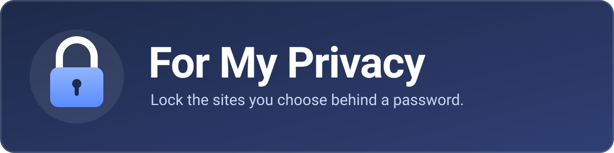
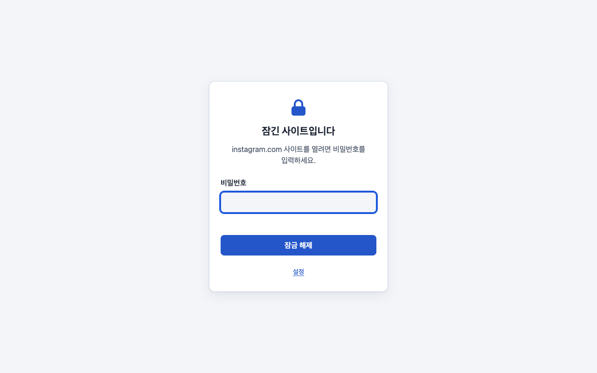
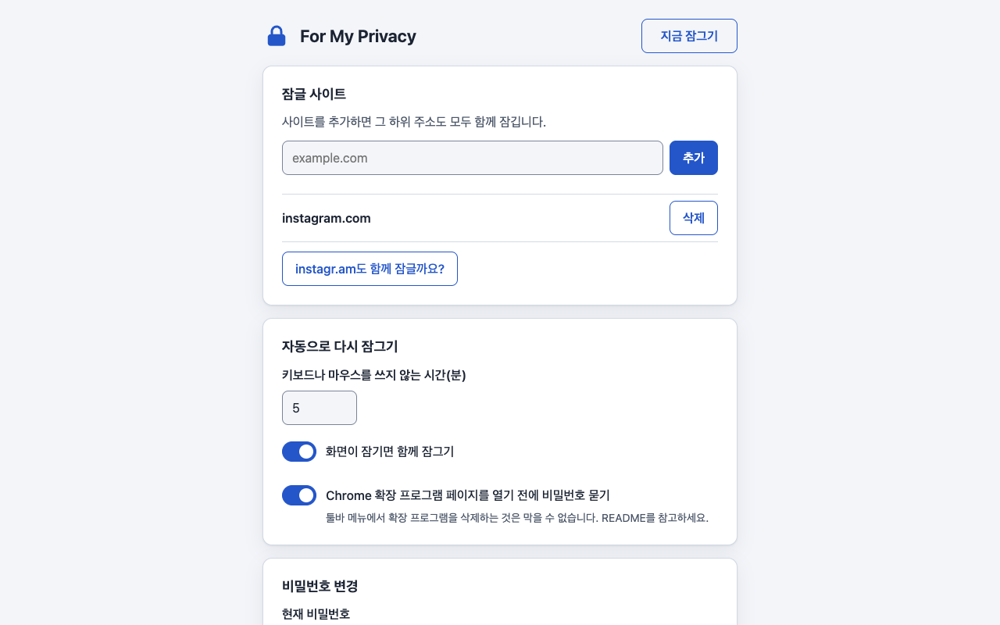
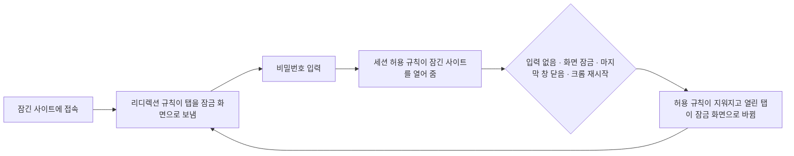

<div align="center">



[English](README.md) · **한국어** · [日本語](README.ja.md)

[](LICENSE)
[](CHANGELOG.md)
[](https://developer.chrome.com/docs/extensions/develop/migrate/what-is-mv3)
[](#설치)

**고른 사이트에 비밀번호를 걸고, 자리를 비우면 다시 잠급니다.**

 

</div>

## 기능

- **사이트 전체를 잠급니다.** `instagram.com`을 추가하면 하위 주소도 모두 잠깁니다(`www.instagram.com`, `help.instagram.com`). `notinstagram.com`처럼 이름만 비슷한 사이트는 건드리지 않습니다.
- **먼저 잠금 화면.** 잠긴 사이트에서는 페이지 대신 잠금 화면이 뜹니다. 링크, 북마크, 주소창, 직접 입력한 주소 모두 마찬가지입니다.
- **비밀번호 하나.** 잠긴 모든 사이트와 설정 화면이 같은 비밀번호로 열립니다. 비밀번호는 salt를 쓴 PBKDF2-SHA256 해시로만 저장되며 되살릴 수 없습니다.
- **알아서 다시 잠깁니다.** 키보드·마우스 입력이 몇 분 동안 없을 때, 화면이 잠길 때, 마지막 크롬 창을 닫을 때, 크롬을 다시 켤 때입니다.
- **열려 있는 탭도 잠깁니다.** 다시 잠길 때 잠긴 사이트의 탭은 잠금 화면으로 바뀌고, 뒤로 가기를 눌러도 원래 페이지가 다시 보이지 않습니다.
- **무작위 대입 방지.** 5번 틀리면 그 뒤로는 시도할 때마다 기다리는 시간이 길어지며, 최대 15분입니다.
- **개인정보 보호.** 네트워크 요청도, 분석 도구도, 계정도 없습니다. 모든 것이 내 컴퓨터 안에만 있습니다.
- **적은 권한.** 사이트 접근은 사이트를 추가할 때 한 곳씩만 요청합니다.
- **한국어·영어·일본어** 화면을 지원합니다.

이 확장 프로그램이 막으려는 상황은 **자리를 비운 사이, 로그인된 내 크롬 앞에 다른 사람이 앉는 것**입니다. 컴퓨터 자체를 장악한 사람을 막는 도구는 아닙니다([막지 못하는 것](#무엇을-막고-무엇은-막지-못하나) 참고).

## 작동 방식



<details>
<summary>그림 뒤의 규칙</summary>

- 잠긴 사이트는 크롬의 `declarativeNetRequest` 규칙으로 막습니다. 페이지 요청을 확장 프로그램의 잠금 화면으로 보내는 리디렉션 규칙이 있고, 같은 도메인에 우선순위가 더 낮은 차단 규칙이 하나 더 있습니다. 툴바 메뉴에서 사이트 접근 권한을 빼도 차단 규칙은 계속 동작하므로, 사이트 내용 대신 차단 화면이 뜹니다.
- 비밀번호가 맞으면 우선순위가 더 높은 허용 규칙을 하나 넣습니다. 이 규칙은 브라우저 세션 동안만 있고, "풀린 상태"는 이 규칙 하나뿐입니다. 크롬을 다시 켜면 규칙이 사라지므로 잠긴 채로 시작합니다.
- 입력 없음 감지는 크롬의 `idle` API를 쓰며, 크롬 안만이 아니라 컴퓨터 전체의 키보드·마우스 입력을 셉니다.
- 다시 잠글 때는 허용 규칙을 지우고, 잠긴 사이트가 열린 탭마다 같은 창, 같은 위치에 잠금 화면 탭을 새로 만듭니다. 기존 탭의 주소만 바꾸면 뒤로 가기에서 크롬 캐시가 원래 페이지를 되살리기 때문에 새 탭을 씁니다.
- 다른 사이트 안에 끼워 넣은(iframe) 잠긴 사이트는 잠금 화면으로 보내지 않고 막기만 합니다.

</details>

## 설치

> **크롬 웹 스토어: 준비 중입니다.** 그때까지는 릴리스 zip 파일을 직접 설치하세요. 1분 정도 걸립니다. 이렇게 설치한 확장 프로그램이 있으면 크롬을 켤 때 개발자 모드 확장 프로그램 안내가 뜨는데, 정상입니다.

1. [Releases](https://github.com/xcryptp/for-my-privacy/releases)에서 `for-my-privacy-0.1.0-chrome.zip`을 내려받습니다. (`-noguard` zip은 확장 관리 화면 보호만 뺀 같은 확장 프로그램입니다.)
2. 압축을 풉니다.
   - macOS: Finder에서 zip 파일을 더블클릭합니다.
   - Windows: zip 파일을 우클릭하고 **모두 압축 풀기**, 이어서 **압축 풀기**를 누릅니다.
3. 압축을 푼 폴더를 오래 둘 곳(예: 문서 폴더)으로 옮깁니다. 크롬은 켤 때마다 이 폴더에서 확장 프로그램을 읽으므로, 나중에 지우거나 옮기면 안 됩니다.
4. 크롬에서 `chrome://extensions`를 엽니다.
5. 오른쪽 위의 **개발자 모드**를 켭니다.
6. **압축해제된 확장 프로그램을 로드합니다**를 눌러 `manifest.json`이 들어 있는 폴더를 고릅니다.
7. 설정 화면이 열리면 비밀번호를 만듭니다.

크롬은 확장 프로그램의 권한을 보여 주는 곳(스토어 페이지, 확장 프로그램 세부정보)에서 `declarativeNetRequest` 권한을 "**모든 페이지의 콘텐츠 차단**"이라고 표시합니다. 사이트 접근 권한이 빠져도 잠긴 사이트를 막으려면 이 권한이 필요합니다. 추가한 사이트에만 동작합니다.

## 사용법

1. **사이트 추가.** 설정을 엽니다(잠금 화면의 **설정**을 누르거나, 확장 프로그램 아이콘을 우클릭해 **옵션**을 고릅니다). **잠글 사이트** 아래에 `instagram.com` 같은 사이트를 입력하고 **추가**를 누릅니다. 크롬이 그 사이트 한 곳에 대한 접근 허용을 물으면 허용합니다.
2. **사이트에 들어가기.** 잠금 화면이 뜹니다. 비밀번호를 넣고 **잠금 해제**를 누르면 사이트가 열립니다.
3. **직접 잠그기.** 설정 화면 맨 위의 **지금 잠그기**를 누릅니다.
4. **다시 잠글 때 정하기.** **자동으로 다시 잠그기** 아래에서 **키보드나 마우스를 쓰지 않는 시간(분)**(1-60, 기본 5)을 정하고, **화면이 잠기면 함께 잠그기**와 **Chrome 확장 프로그램 페이지를 열기 전에 비밀번호 묻기**를 켜거나 끕니다. 두 번째 스위치는 `-noguard` 빌드에는 없습니다.

비밀번호를 잊으면 확장 프로그램을 삭제하고 다시 설치하세요. 비밀번호와 사이트 목록이 지워집니다.

## 무엇을 막고 무엇은 막지 못하나

For My Privacy는 로그인된 내 크롬을 쓰는 사람이 잠가 둔 사이트를 여는 것을 막습니다. 아래는 막지 **못합니다**.

| 항목 | 이유 | 도움이 되는 것 |
| --- | --- | --- |
| 툴바 메뉴에서 확장 프로그램 삭제 | 크롬은 누구나 확장 프로그램을 지울 수 있게 합니다 | [크롬 정책](#크롬-정책으로-더-단단하게) |
| 확장 프로그램을 끄고 크롬을 실행하거나 프로필 파일을 고치는 것 | 확장 프로그램 바깥에서 일어나는 일입니다 | [크롬 정책](#크롬-정책으로-더-단단하게) |
| 크롬 개발자 도구 | 개발자 도구를 아는 사람까지 막는다고 약속하지 않습니다 | [크롬 정책](#크롬-정책으로-더-단단하게) |
| 방문 기록, 주소창 추천, 탭 검색에 남는 페이지 제목 | 크롬이 보관합니다 | 0.1.0에서는 없음 |
| 메시지 미리보기 같은 사이트 알림 | 0.1.0에서는 막지 않습니다 | 0.1.0에서는 없음 |
| 다른 탭에 이미 열려 있던 페이지 안에 끼워 넣은 잠긴 사이트 | 그 페이지를 새로 고치기 전까지 내용이 남습니다 | 0.1.0에서는 없음 |
| 시크릿 창과 게스트 창 | 내 로그인이 없고, 확장 프로그램도 기본으로 꺼져 있습니다 | 이 도구가 막으려는 상황이 아닙니다 |

컴퓨터의 관리자라면 확장 프로그램이나 정책이 한 일을 되돌릴 수 있습니다. 관리자 비밀번호를 다른 사람이 가지고 있을 때가 가장 단단한 설정입니다.

## 크롬 정책으로 더 단단하게

<details>
<summary>선택 사항: 개발자 도구를 끄고 확장 프로그램을 지우지 못하게 하기</summary>

크롬에는 공식 관리 정책이 있습니다. 그중 두 가지가 위의 가장 큰 빈틈을 메웁니다.

| 정책 | 값 | 하는 일 |
| --- | --- | --- |
| `DeveloperToolsAvailability` | `2` | 크롬 개발자 도구를 어디서든 끕니다 |
| `ExtensionInstallForcelist` | `<EXTENSION_ID>;https://clients2.google.com/service/update2/crx` | 크롬 웹 스토어에서 확장 프로그램을 설치하고 유지합니다. 툴바 메뉴에서 끄거나 지울 수 없게 됩니다 |

> **경고: 아직 확인하지 못했습니다.** `DeveloperToolsAvailability = 2`가 `chrome://extensions`의 개발자 모드까지 함께 끌 수 있습니다(크롬의 `ExtensionDeveloperModeSettings` 정책이 설정되지 않았을 때 이 값을 따를 수 있다고 보지만, 확인하지 못했습니다). 그렇다면 압축해제로 올린 확장 프로그램([설치](#설치) 참고)은 다시 불러오거나 업데이트할 수 없게 되고, 크롬이 아예 꺼 버릴 수도 있습니다. **이 정책은 주로 스토어로 설치한 경우를 위한 것입니다.** 압축해제로 올렸다면 업데이트하기 전에 정책을 먼저 지우세요. 압축해제 설치와 개발자 도구만 끄는 정책을 함께 쓰는 경우는 아직 시험하지 않았으며, [`docs/manual-checks.md`](docs/manual-checks.md)의 15번 항목입니다.

바로 쓸 수 있는 파일입니다.

- macOS: [`docs/hardening/macos/for-my-privacy-chrome.mobileconfig`](docs/hardening/macos/for-my-privacy-chrome.mobileconfig) (구성 프로필, 페이로드 유형 `com.google.Chrome`)
- Windows: [`docs/hardening/windows/for-my-privacy-chrome.reg`](docs/hardening/windows/for-my-privacy-chrome.reg) (`HKLM\SOFTWARE\Policies\Google\Chrome`과 `...\ExtensionInstallForcelist` 아래의 레지스트리 키)

강제 설치 정책에는 확장 프로그램의 크롬 웹 스토어 ID가 필요하며, 스토어에 등록된 뒤에야 생깁니다. 파일의 `<EXTENSION_ID>`(꺾쇠 괄호 포함)를 32자 ID로 바꾸세요. 스토어 버전과 압축해제로 올린 버전은 저장 공간과 비밀번호가 따로인 서로 다른 확장 프로그램이므로, 스토어 버전을 강제 설치하기 전에 압축해제로 올린 쪽을 먼저 삭제하세요. 그 전에는 강제 설치 부분을 지우세요. 개발자 도구 정책만 따로 쓰기 전에 아래 경고를 읽어 보세요.

**macOS**

1. `.mobileconfig` 파일을 텍스트 편집기로 열어 `&lt;EXTENSION_ID&gt;`를 32자 ID로 바꿉니다(파일이 XML이라 꺾쇠 괄호가 `&lt;`와 `&gt;`로 적혀 있습니다).
2. 파일을 더블클릭합니다. 프로필이 내려받아졌다는 안내가 뜹니다.
3. 시스템 설정에서 **프로필**을 찾아(개인정보 보호 및 보안 아래, 최신 macOS에서는 일반의 기기 관리) 프로필을 고르고 **설치**를 누릅니다. 관리자 비밀번호를 입력합니다.
4. 크롬을 다시 켜고 `chrome://policy`를 열어 **정책 다시 로드**를 누릅니다. 두 정책이 모두 보여야 합니다.
5. 되돌리려면 같은 프로필 화면에서 프로필을 삭제합니다.

**Windows**

1. `.reg` 파일을 우클릭해 **편집**을 고르거나(Windows 11에서는 **추가 옵션 표시** 안에 있습니다) 메모장으로 열어 `<EXTENSION_ID>`(꺾쇠 괄호 포함)를 ID로 바꿉니다.
2. 파일을 더블클릭하고 관리자 권한 확인에 동의합니다.
3. 크롬을 다시 켜고 `chrome://policy`를 열어 **정책 다시 로드**를 누릅니다. 두 정책이 모두 보여야 합니다.
4. 되돌리려면 레지스트리 편집기에서 `HKLM\SOFTWARE\Policies\Google\Chrome`의 `DeveloperToolsAvailability` 값과 `ExtensionInstallForcelist` 키를 지웁니다.

이 정책은 크롬의 실제 관리 기능입니다. 컴퓨터의 관리자라면 이것도 지울 수 있으므로, 관리자 비밀번호를 다른 사람이 가지고 있을 때가 가장 단단한 설정입니다.

</details>

## 개인정보

컴퓨터 밖으로 나가는 것은 없습니다. 비밀번호 해시, 사이트 목록, 설정은 `chrome.storage.local`에 보관되며, 네트워크 요청도 분석 도구도 없습니다. 자세한 내용은 영어·한국어·일본어로 [PRIVACY.md](PRIVACY.md)에 있습니다.

## 개발

Node 22 이상이 필요합니다(CI는 Node 24).

<details>
<summary>스크립트와 빌드 시험 방법</summary>

```sh
npm ci                  # 설치
npm run dev             # 고치는 동안 빌드하고 다시 불러오기
npm run build           # .output/chrome-mv3에 배포용 빌드
npm run build:noguard   # 같은 빌드, 확장 관리 화면 보호만 뺌
npm test                # 단위 테스트 (Vitest)
npm run test:e2e        # e2e 모드를 빌드하고 브라우저 테스트 실행 (Playwright)
npm run zip             # 스토어용 zip. noguard zip은 npm run zip:noguard
```

브라우저 테스트를 처음 돌리려면 Chromium이 필요합니다: `npx playwright install chromium`.

빌드를 시험하려면 [설치](#설치)처럼 `.output/chrome-mv3`를 **압축해제된 확장 프로그램을 로드합니다**로 불러옵니다. 이 README의 스크린샷은 `npm run build` 뒤에 `node scripts/screenshots.ts`로 만듭니다(`.ts` 파일을 바로 실행하므로 Node 22.18 이상 또는 23.6 이상이 필요합니다). 자동화할 수 없는 직접 확인 목록은 [`docs/manual-checks.md`](docs/manual-checks.md)에 있습니다. 빌드에 들어간 외부 코드 조각의 라이선스는 [THIRD_PARTY_LICENSES](THIRD_PARTY_LICENSES)에 있습니다.

</details>

## 릴리스

[RELEASING.md](RELEASING.md)를 보세요. 버전을 올리고, [CHANGELOG.md](CHANGELOG.md)를 고치고, 태그를 달면 릴리스 워크플로가 zip을 만듭니다.

## 라이선스

[MIT](LICENSE) © 2026 xcryptp
