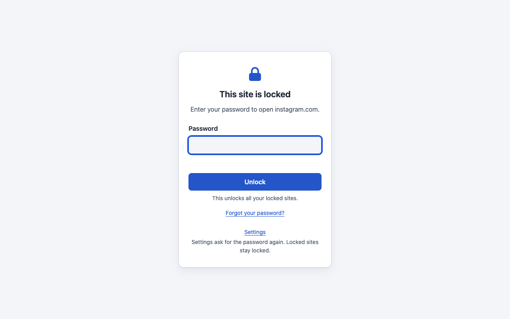
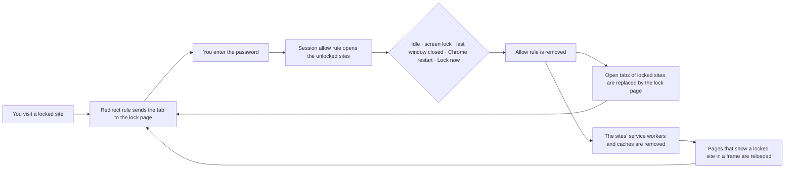

<div align="center">


**English** · [한국어](README.ko.md) · [日本語](README.ja.md)

[](LICENSE)
[](CHANGELOG.md)
[](https://developer.chrome.com/docs/extensions/develop/migrate/what-is-mv3)
[](#install)

**Put a password on the sites you choose, and lock them again when you step away.**

 

</div>

## Features

- **Locks whole sites.** Paste `instagram.com` or any full link. The site and every address under it lock, at any depth (`www.instagram.com`, `help.instagram.com`, `a.b.instagram.com`). A site is always locked as a whole: a link to one page or subdomain locks the entire registrable domain. A Naver blog link locks all of `naver.com`, and a Gmail link locks all of `google.com`, Search included. One subdomain cannot be locked on its own. Sites on shared hosts such as `user.github.io` count as their own site. Look-alike names such as `notinstagram.com` are left alone.
- **Lock screen first.** A locked site shows a lock screen instead of the page. Links, bookmarks, the address bar and typed addresses all end up there. The lock screen names the site but not the page you tried to open, and the address bar shows a random code instead of the page address.
- **One password.** It opens your locked sites and the settings page, and each has its own unlock: the lock screen opens sites, and settings ask again. It is stored only as a salted PBKDF2-SHA256 hash and cannot be recovered.
- **You choose how far one unlock reaches.** By default one unlock opens every locked site. In Security you can switch to opening only the site you unlocked.
- **Locks again by itself.** After minutes without keyboard or mouse input, when the screen locks, when the last Chrome window closes, and when Chrome restarts.
- **Quick lock.** The toolbar button (**Lock now**) and the keyboard shortcut Alt+Shift+L lock everything at once, without a password.
- **Open tabs lock too.** When the lock comes back, tabs of locked sites are replaced by the lock screen, and Back does not bring the old page back. A locked site shown inside another page is blocked, and pages that embed a locked site are reloaded when the lock comes back.
- **Saved copies are removed.** A site's own service workers and caches are removed each time the lock comes back, so a site cannot answer from its saved copy. Cookies and logins are left alone.
- **Brute-force wait.** The lock screen says how many tries are left. After 5 wrong tries a wait starts at 30 seconds and doubles with each try, up to 15 minutes, with a countdown.
- **First-run setup in four steps.** Welcome, password, choose sites (one-tap choices for common sites), auto-lock. A forgotten password has help on the lock screen.
- **Private.** No network requests, no analytics, no account. Everything stays on your computer.
- **Small permissions.** Site access is asked for one site at a time, when you add it.
- **English, Korean and Japanese** screens.

The threat it is built for: **someone else sitting at your unlocked, logged-in Chrome while you are away.** It is not a defence against someone who controls your computer (see [what it does not stop](#what-it-protects-and-what-it-does-not)).

## How it works



<details>
<summary>The rules behind the diagram</summary>

- Locked sites are blocked with Chrome's own `declarativeNetRequest` rules. A redirect rule (the higher priority) sends the page request to the extension's lock page. A block rule for the same domains has a lower priority and is the backup: it covers every kind of request, so it keeps working even if site access is withdrawn from the toolbar menu (the site shows a blocked page, never its content), and it blocks a locked site inside a frame on another page and anything a saved copy of a locked page asks for.
- Unlocking adds one higher-priority allow rule that lives only for the browser session. It is the only "unlocked" state there is. It lists every locked site, or only the one you unlocked, depending on the Security setting **When I unlock a site**. Changing that setting removes the rule, so your sites lock again (the settings stay open). Restarting Chrome clears the rule, so Chrome starts locked.
- Idle detection uses Chrome's `idle` API and counts keyboard and mouse input on the whole computer, not only in Chrome.
- Re-locking removes the allow rule and replaces each open tab of a locked site with a new lock-page tab in the same window and position. A new tab is used because changing the address of an old tab would let Back bring its page back from Chrome's cache. For the same reason, a tab that showed a locked site earlier and has since moved on to another site is reopened as a new tab at the same address, without its history. An unlock sends the open lock screens whose site it opened back to that site. The settings lock again too.
- A site's own service worker can answer a page without the request ever reaching Chrome's rules, so the rules alone would miss it. Each re-lock, each Chrome start and each newly locked site therefore removes the service workers and cache storage of the locked sites (the `browsingData` permission, which Chrome shows no warning for). Cookies, logins and other site data stay. This covers the site's own address, its `www.` and `m.` addresses, and every other address under it that a tab or frame has shown; the extension keeps those addresses in local storage for this.
- The `webNavigation` permission lets the extension see frames. When the lock comes back, every tab that shows a locked site inside a frame is reloaded and keeps its history; a tab that cannot be reloaded (for example while a "leave this page?" question is open) is replaced instead. A frame that still appears while locked gets the same treatment, and if it comes back once more, its tab shows the lock page.
- The `tabs` permission lets the extension notice a page of a locked site that loaded anyway, for example one answered from a service worker, or one on a site whose access was withdrawn. The tab is replaced by the lock page. A split second of the old page, or of Chrome's blocked page, can show first.
- The lock page gets only a random code. The page address you were going to open stays in the extension's session memory, tied to that tab, until you unlock or the tab closes.

</details>

## Install

> **Chrome Web Store: coming soon.** Until then, install the release zip by hand. It takes about a minute. Chrome shows a notice about developer-mode extensions when it starts; that is normal for extensions installed this way.

1. Download `for-my-privacy-0.1.0-chrome.zip` from [Releases](https://github.com/xcryptp/for-my-privacy/releases). (The `-noguard` zip is the same extension without the extensions-page guard.)
2. Unzip it.
   - macOS: double-click the zip in Finder.
   - Windows: right-click the zip, choose **Extract All**, then **Extract**.
3. Move the unzipped folder somewhere permanent (for example your Documents folder). Chrome reads the extension from this folder every time it starts, so do not delete or move it later.
4. In Chrome, open `chrome://extensions`.
5. Turn on **Developer mode** (top right).
6. Click **Load unpacked** and choose the folder that contains `manifest.json`.
7. The settings page opens and walks you through a short setup (see [Use](#use)).

Wherever Chrome shows an extension's permissions (the store page, the extension's details), it shows two warnings. `declarativeNetRequest` shows as "**Block content on any page**": For My Privacy needs it to block locked sites even when site access is withdrawn, and it only acts on the sites you add. `tabs` and `webNavigation` share the second one, "**Read your browsing history**": they let the extension find tabs and frames that show a locked site. It compares their addresses with your list of locked sites and sends nothing anywhere. The other permissions, `storage`, `idle` and `browsingData`, have no warning in Chrome. Site access is optional and asked for one site at a time.

## Use

1. **Set up.** After you load the extension, the settings page opens with four steps. Click **Get started**. Create a password (the page warns that it cannot be recovered). Under **Choose sites to lock**, tap the sites you want (instagram.com, facebook.com, x.com, tiktok.com, youtube.com) or type another one under **Another site**, then click **Next** (**Skip** if you choose none). Chrome asks to allow access to the chosen sites; choose Allow. Last, set **Lock again automatically** and click **Finish**. Your sites are locked right away. The password you just made does not unlock them.
2. **Add or remove a site later.** Open Settings (on the lock screen click **Settings**, in the toolbar popup click **Open settings**, or right-click the extension icon and choose **Options**). The settings page opens on **Sites**. Type a site or paste a full address under **Locked sites**, and click **Add**. A line under the box says what will lock, for example all of `naver.com` for a Naver blog link. Chrome asks to allow access to that site; allow it. **Remove** takes a site off the list.
3. **Visit a locked site.** The lock screen appears. Enter your password and click **Unlock** to open the site. The lock screen tells you how many tries are left before a wait, and under the button what this unlock opens.
4. **Lock it yourself.** Click the extension icon in the toolbar (pin it from the puzzle-piece menu first if you cannot see it) and click **Lock now**, or press the shortcut, Alt+Shift+L by default (macOS shows it as Option+Shift+L). Neither asks for a password. Chrome may leave the shortcut unset if another extension already uses it; the popup shows the key that is set, and you can change it at `chrome://extensions/shortcuts`. **Lock now** at the top of the settings page does the same.
5. **Choose when it locks again.** Under **Auto-lock**, set **Minutes without keyboard or mouse input** (1-60, default 5) and switch **Lock when the screen locks** on or off.
6. **Choose how far one unlock reaches.** Under **Security**, **When I unlock a site** has two choices: **Unlock all locked sites together** (the default: one unlock opens every locked site and Chrome's extensions page) and **Unlock only that site** (an unlock opens only the site on the lock screen and every address under it; Chrome's extensions page then opens only from its own lock screen). Changing it locks your sites again at once; the settings stay open.
7. **Guard the extensions page.** Also under **Security**, switch **Ask for the password before Chrome's extensions page opens** on or off. This switch is not in the `-noguard` build.

Settings open with the password too, but separately from the sites: unlocking a site does not open the settings, and unlocking the settings does not open any site. **Change password** is also under **Security**.

If you forget the password, it cannot be recovered. The lock screen and the locked settings page have a **Forgot your password?** note that says how to start over: click the puzzle-piece icon in the Chrome toolbar, click the three-dot menu next to For My Privacy, choose "Remove from Chrome", then install the extension again. This erases the password and the site list.

## What it protects and what it does not

For My Privacy stops a person who has your unlocked Chrome from opening the sites you locked. A locked site shown inside another page is blocked too, and a site's own service worker cannot answer for it. It does **not** stop these:

| What | Why | What helps |
| --- | --- | --- |
| Removing the extension from the toolbar menu | Chrome lets anyone remove an extension | [Chrome policies](#make-it-stronger-with-chrome-policies) |
| Starting Chrome with extensions off (a launch flag such as `--disable-extensions`), or editing profile files | It happens outside the extension | [Chrome policies](#make-it-stronger-with-chrome-policies) |
| Chrome's **Reset settings** (`chrome://settings/reset`) | It turns off every extension, this one included | [Chrome policies](#make-it-stronger-with-chrome-policies) |
| Chrome DevTools | The extension does not promise to stop someone who knows DevTools | [Chrome policies](#make-it-stronger-with-chrome-policies) |
| Page titles in history, address-bar suggestions and tab search | Chrome keeps them | Nothing in 0.1.0 |
| Site notifications, such as message previews | A site can still show notifications while you have it unlocked. Each lock removes the site's service worker, so its web-push notifications also stop until you visit the site again while unlocked | Nothing in 0.1.0 |
| Websites knowing the extension is installed | The lock page is a web-accessible page, so any website can find out that For My Privacy is installed (not what you locked) | Nothing in 0.1.0 |
| A split-second look at a saved page | If a site's service worker cannot be removed in time, its saved page can show for a moment before the lock screen replaces it. For a site whose access was withdrawn, Chrome's blocked page can show first | Keep site access allowed. Settings shows **Grant access** when it was withdrawn |
| Tabs Chrome restores when it starts | A restored tab can show a site's saved page for a moment, until the extension has replaced it with the lock screen | Nothing in 0.1.0 |
| Incognito and Guest windows | Your logins are not there, and the extension is off there by default | Not the situation it is built for |

If you are the computer's administrator, you can undo anything an extension or a policy does. The strongest setup is when someone else holds the admin password.

## Make it stronger with Chrome policies

<details>
<summary>Optional: turn off DevTools and stop the extension from being removed</summary>

Chrome has official management policies. Two of them close the biggest gaps above:

| Policy | Value | What it does |
| --- | --- | --- |
| `DeveloperToolsAvailability` | `2` | Turns Chrome DevTools off everywhere |
| `ExtensionInstallForcelist` | `<EXTENSION_ID>;https://clients2.google.com/service/update2/crx` | Installs the extension from the Chrome Web Store and keeps it: it cannot be switched off or removed from the toolbar menu |

> **Warning: not verified yet.** `DeveloperToolsAvailability = 2` may also switch off Developer mode on `chrome://extensions` (Chrome's `ExtensionDeveloperModeSettings` policy may follow it when it is not set; this is unverified). If it does, an unpacked install (see [Install](#install)) could no longer be reloaded or updated, and Chrome might even disable it. **These policies are mainly meant for a store install.** If you installed the unpacked zip, remove the policy before you update it. The unpacked install together with the DevTools-only policy has not been tested; it is item 15 in [`docs/manual-checks.md`](docs/manual-checks.md).

Ready-made files:

- macOS: [`docs/hardening/macos/for-my-privacy-chrome.mobileconfig`](docs/hardening/macos/for-my-privacy-chrome.mobileconfig) (a configuration profile, payload type `com.google.Chrome`)
- Windows: [`docs/hardening/windows/for-my-privacy-chrome.reg`](docs/hardening/windows/for-my-privacy-chrome.reg) (registry keys under `HKLM\SOFTWARE\Policies\Google\Chrome` and `...\ExtensionInstallForcelist`)

The force-install policy needs the extension's Chrome Web Store ID, which exists once the store listing is live. Replace `<EXTENSION_ID>` in the file (brackets included) with the 32-letter ID. Until then, delete the force-install part. The store copy and an unpacked copy are two separate extensions with separate storage and passwords, so remove the unpacked copy before you force-install the store version. Read the warning above before you use the DevTools policy on its own.

**macOS**

1. Open the `.mobileconfig` file in a text editor and replace `&lt;EXTENSION_ID&gt;` with the plain 32-letter ID (the file is XML, so the angle brackets are written as `&lt;` and `&gt;`).
2. Double-click the file. macOS says a profile was downloaded.
3. Open System Settings, find **Profiles** (under Privacy & Security, or General, Device Management on newer macOS), select the profile and click **Install**. Enter an administrator password.
4. Restart Chrome and open `chrome://policy`; click **Reload policies**. Both policies should be listed.
5. To undo: remove the profile in the same Profiles screen.

**Windows**

1. Right-click the `.reg` file, choose **Edit** (on Windows 11 it is under **Show more options**) or open it in Notepad, and replace `<EXTENSION_ID>` (brackets included) with the ID.
2. Double-click the file and accept the administrator prompt.
3. Restart Chrome and open `chrome://policy`; click **Reload policies**. Both policies should be listed.
4. To undo: delete the `DeveloperToolsAvailability` value and the `ExtensionInstallForcelist` key from `HKLM\SOFTWARE\Policies\Google\Chrome` in Registry Editor.

These policies are real Chrome management. If you are the computer's administrator, you can remove them too, so the strongest setup is when someone else holds the admin password.

</details>

## Privacy

Nothing leaves your computer. The password hash, your site list, your settings, the wrong-try count and wait, and the addresses of locked-site subdomains that tabs showed (kept to remove their saved workers and caches) are kept in `chrome.storage.local`; there are no network requests and no analytics. Details, in English, Korean and Japanese: [PRIVACY.md](PRIVACY.md).

## Development

You need Node 22 or newer (CI uses Node 24).

<details>
<summary>Scripts and how to try a build</summary>

```sh
npm ci                  # install
npm run dev             # build and reload while you edit
npm run build           # production build in .output/chrome-mv3
npm run build:noguard   # same, without the extensions-page guard
npm test                # unit tests (Vitest)
npm run test:e2e        # build the e2e mode and run the browser tests (Playwright)
npm run zip             # store zip; npm run zip:noguard for the noguard zip
```

The first browser test run needs Chromium: `npx playwright install chromium`.

To try a build, load `.output/chrome-mv3` with **Load unpacked** as in [Install](#install). Screenshots in this README are made by `node scripts/screenshots.ts` after `npm run build` (it runs a `.ts` file directly, which needs Node 22.18+ or 23.6+). Hand checks that cannot be automated are in [`docs/manual-checks.md`](docs/manual-checks.md). Licenses of the few third-party pieces inside the build: [THIRD_PARTY_LICENSES](THIRD_PARTY_LICENSES).

</details>

## Releasing

See [RELEASING.md](RELEASING.md): bump the version, update [CHANGELOG.md](CHANGELOG.md), tag, and the release workflow builds the zips.

## License

[MIT](LICENSE) © 2026 xcryptp
