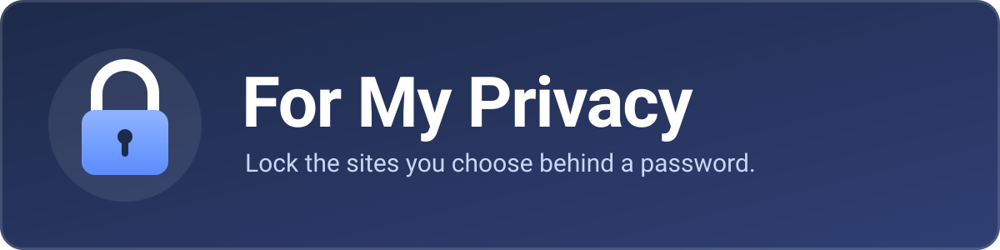
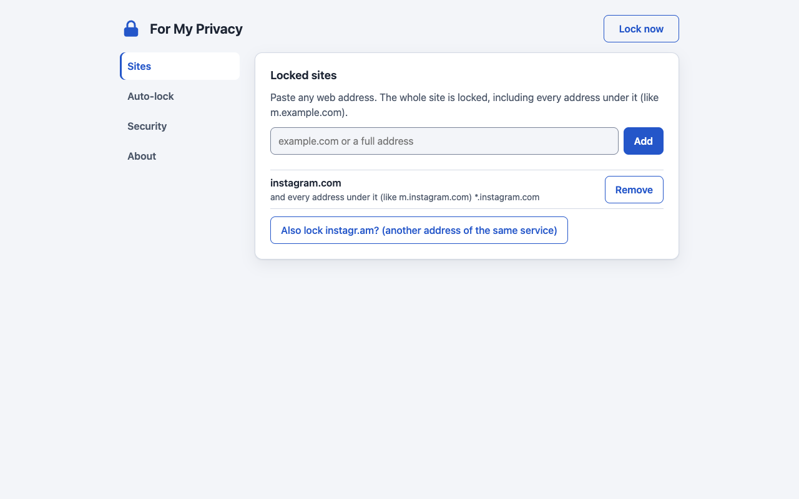
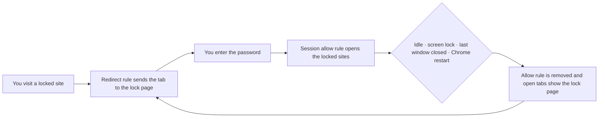

<div align="center">



**English** · [한국어](README.ko.md) · [日本語](README.ja.md)

[](LICENSE)
[](CHANGELOG.md)
[](https://developer.chrome.com/docs/extensions/develop/migrate/what-is-mv3)
[](#install)

**Put a password on the sites you choose, and lock them again when you step away.**

 

</div>

## Features

- **Locks whole sites.** Add `instagram.com` and every subdomain locks too (`www.instagram.com`, `help.instagram.com`). Look-alike names such as `notinstagram.com` are left alone.
- **Lock screen first.** A locked site shows a lock screen instead of the page. Links, bookmarks, the address bar and typed addresses all end up there.
- **One password.** It opens every locked site and the settings page. It is stored only as a salted PBKDF2-SHA256 hash and cannot be recovered.
- **Locks again by itself.** After minutes without keyboard or mouse input, when the screen locks, when the last Chrome window closes, and when Chrome restarts.
- **Open tabs lock too.** When the lock comes back, tabs of locked sites are replaced by the lock screen, and Back does not bring the old page back.
- **Brute-force wait.** After 5 wrong tries the wait grows with each try, up to 15 minutes.
- **Private.** No network requests, no analytics, no account. Everything stays on your computer.
- **Small permissions.** Site access is asked for one site at a time, when you add it.
- **English, Korean and Japanese** screens.

The threat it is built for: **someone else sitting at your unlocked, logged-in Chrome while you are away.** It is not a defence against someone who controls your computer (see [what it does not stop](#what-it-protects-and-what-it-does-not)).

## How it works



<details>
<summary>The rules behind the diagram</summary>

- Locked sites are blocked with Chrome's own `declarativeNetRequest` rules. A redirect rule (the higher priority) sends the page request to the extension's lock page. A block rule for the same domains has a lower priority and is the backup: it keeps working even if site access is withdrawn from the toolbar menu, so the site shows a blocked page, never its content.
- Unlocking adds one higher-priority allow rule that lives only for the browser session. It is the only "unlocked" state there is. Restarting Chrome clears it, so Chrome starts locked.
- Idle detection uses Chrome's `idle` API and counts keyboard and mouse input on the whole computer, not only in Chrome.
- Re-locking removes the allow rule and replaces each open tab of a locked site with a new lock-page tab in the same window and position. A new tab is used because changing the address of an old tab would let Back bring its page back from Chrome's cache. For the same reason, a tab that showed a locked site earlier and has since moved on to another site is reopened as a new tab at the same address, without its history. One unlock sends every open lock screen back to its site.
- Sites framed inside other sites are blocked, not redirected.

</details>

## Install

> **Chrome Web Store: coming soon.** Until then, install the release zip by hand. It takes about a minute. Chrome shows a notice about developer-mode extensions when it starts; that is normal for extensions installed this way.

1. Download `for-my-privacy-0.1.0-chrome.zip` from [Releases](https://github.com/xcryptp/for-my-privacy/releases). (The `-noguard` zip is the same extension without the extensions-page guard.)
2. Unzip it.
   - macOS: double-click the zip in Finder.
   - Windows: right-click the zip, choose **Extract All**, then **Extract**.
3. Move the unzipped folder somewhere permanent (for example your Documents folder). Chrome reads the extension from this folder every time it starts, so do not delete or move it later.
4. In Chrome, open `chrome://extensions`.
5. Turn on **Developer mode** (top right).
6. Click **Load unpacked** and choose the folder that contains `manifest.json`.
7. The settings page opens. Create your password.

Wherever Chrome shows an extension's permissions (the store page, the extension's details), it lists the `declarativeNetRequest` permission as "**Block content on any page**". For My Privacy needs this permission to block locked sites even when site access is withdrawn. It only acts on the sites you add.

## Use

1. **Add a site.** Open Settings (on the lock screen click **Settings**, or right-click the extension icon and choose **Options**). Under **Locked sites**, type a site such as `instagram.com` and click **Add**. Chrome asks to allow access to that one site; allow it.
2. **Visit it.** The lock screen appears. Enter your password and click **Unlock** to open the site.
3. **Lock it yourself.** Click **Lock now** at the top of the settings page.
4. **Choose when it locks again.** Under **Lock again automatically**, set **Minutes without keyboard or mouse input** (1-60, default 5), and switch **Lock when the screen locks** and **Ask for the password before Chrome's extensions page opens** on or off. The second switch is not in the `-noguard` build.

If you forget the password, remove the extension and install it again. That erases the password and the site list.

## What it protects and what it does not

For My Privacy stops a person who has your unlocked Chrome from opening the sites you locked. It does **not** stop these:

| What | Why | What helps |
| --- | --- | --- |
| Removing the extension from the toolbar menu | Chrome lets anyone remove an extension | [Chrome policies](#make-it-stronger-with-chrome-policies) |
| Starting Chrome with extensions off, or editing profile files | It happens outside the extension | [Chrome policies](#make-it-stronger-with-chrome-policies) |
| Chrome's **Reset settings** (`chrome://settings/reset`) | It turns off every extension, this one included | [Chrome policies](#make-it-stronger-with-chrome-policies) |
| Chrome DevTools | The extension does not promise to stop someone who knows DevTools | [Chrome policies](#make-it-stronger-with-chrome-policies) |
| Page titles in history, address-bar suggestions and tab search | Chrome keeps them | Nothing in 0.1.0 |
| Site notifications, such as message previews | Not blocked in 0.1.0 | Nothing in 0.1.0 |
| A locked site embedded in a page that was already loaded in another tab | It keeps its content until that page is reloaded | Nothing in 0.1.0 |
| Incognito and Guest windows | Your logins are not there, and the extension is off there by default | Not the situation it is built for |

If you are the computer's administrator, you can undo anything an extension or a policy does. The strongest setup is when someone else holds the admin password.

## Make it stronger with Chrome policies

<details>
<summary>Optional: turn off DevTools and stop the extension from being removed</summary>

Chrome has official management policies. Two of them close the biggest gaps above:

| Policy | Value | What it does |
| --- | --- | --- |
| `DeveloperToolsAvailability` | `2` | Turns Chrome DevTools off everywhere |
| `ExtensionInstallForcelist` | `<EXTENSION_ID>;https://clients2.google.com/service/update2/crx` | Installs the extension from the Chrome Web Store and keeps it: it cannot be switched off or removed from the toolbar menu |

> **Warning: not verified yet.** `DeveloperToolsAvailability = 2` may also switch off Developer mode on `chrome://extensions` (Chrome's `ExtensionDeveloperModeSettings` policy may follow it when it is not set; this is unverified). If it does, an unpacked install (see [Install](#install)) could no longer be reloaded or updated, and Chrome might even disable it. **These policies are mainly meant for a store install.** If you installed the unpacked zip, remove the policy before you update it. The unpacked install together with the DevTools-only policy has not been tested; it is item 15 in [`docs/manual-checks.md`](docs/manual-checks.md).

Ready-made files:

- macOS: [`docs/hardening/macos/for-my-privacy-chrome.mobileconfig`](docs/hardening/macos/for-my-privacy-chrome.mobileconfig) (a configuration profile, payload type `com.google.Chrome`)
- Windows: [`docs/hardening/windows/for-my-privacy-chrome.reg`](docs/hardening/windows/for-my-privacy-chrome.reg) (registry keys under `HKLM\SOFTWARE\Policies\Google\Chrome` and `...\ExtensionInstallForcelist`)

The force-install policy needs the extension's Chrome Web Store ID, which exists once the store listing is live. Replace `<EXTENSION_ID>` in the file (brackets included) with the 32-letter ID. Until then, delete the force-install part. The store copy and an unpacked copy are two separate extensions with separate storage and passwords, so remove the unpacked copy before you force-install the store version. Read the warning above before you use the DevTools policy on its own.

**macOS**

1. Open the `.mobileconfig` file in a text editor and replace `&lt;EXTENSION_ID&gt;` with the plain 32-letter ID (the file is XML, so the angle brackets are written as `&lt;` and `&gt;`).
2. Double-click the file. macOS says a profile was downloaded.
3. Open System Settings, find **Profiles** (under Privacy & Security, or General, Device Management on newer macOS), select the profile and click **Install**. Enter an administrator password.
4. Restart Chrome and open `chrome://policy`; click **Reload policies**. Both policies should be listed.
5. To undo: remove the profile in the same Profiles screen.

**Windows**

1. Right-click the `.reg` file, choose **Edit** (on Windows 11 it is under **Show more options**) or open it in Notepad, and replace `<EXTENSION_ID>` (brackets included) with the ID.
2. Double-click the file and accept the administrator prompt.
3. Restart Chrome and open `chrome://policy`; click **Reload policies**. Both policies should be listed.
4. To undo: delete the `DeveloperToolsAvailability` value and the `ExtensionInstallForcelist` key from `HKLM\SOFTWARE\Policies\Google\Chrome` in Registry Editor.

These policies are real Chrome management. If you are the computer's administrator, you can remove them too, so the strongest setup is when someone else holds the admin password.

</details>

## Privacy

Nothing leaves your computer. The password hash, your site list and your settings are kept in `chrome.storage.local`; there are no network requests and no analytics. Details, in English, Korean and Japanese: [PRIVACY.md](PRIVACY.md).

## Development

You need Node 22 or newer (CI uses Node 24).

<details>
<summary>Scripts and how to try a build</summary>

```sh
npm ci                  # install
npm run dev             # build and reload while you edit
npm run build           # production build in .output/chrome-mv3
npm run build:noguard   # same, without the extensions-page guard
npm test                # unit tests (Vitest)
npm run test:e2e        # build the e2e mode and run the browser tests (Playwright)
npm run zip             # store zip; npm run zip:noguard for the noguard zip
```

The first browser test run needs Chromium: `npx playwright install chromium`.

To try a build, load `.output/chrome-mv3` with **Load unpacked** as in [Install](#install). Screenshots in this README are made by `node scripts/screenshots.ts` after `npm run build` (it runs a `.ts` file directly, which needs Node 22.18+ or 23.6+). Hand checks that cannot be automated are in [`docs/manual-checks.md`](docs/manual-checks.md). Licenses of the few third-party pieces inside the build: [THIRD_PARTY_LICENSES](THIRD_PARTY_LICENSES).

</details>

## Releasing

See [RELEASING.md](RELEASING.md): bump the version, update [CHANGELOG.md](CHANGELOG.md), tag, and the release workflow builds the zips.

## License

[MIT](LICENSE) © 2026 xcryptp
