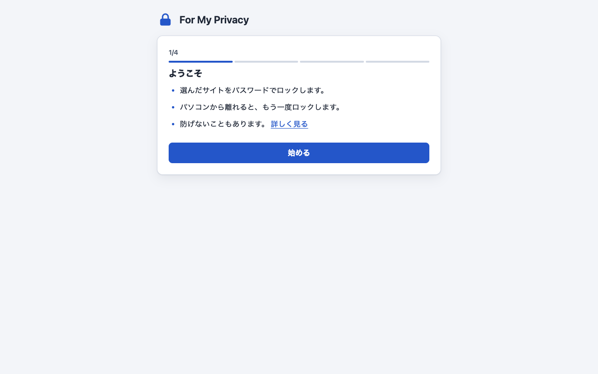
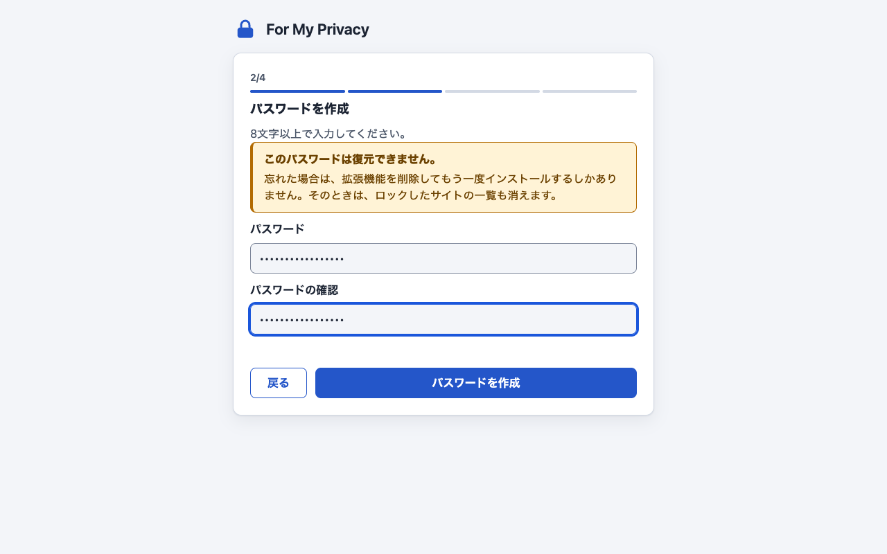
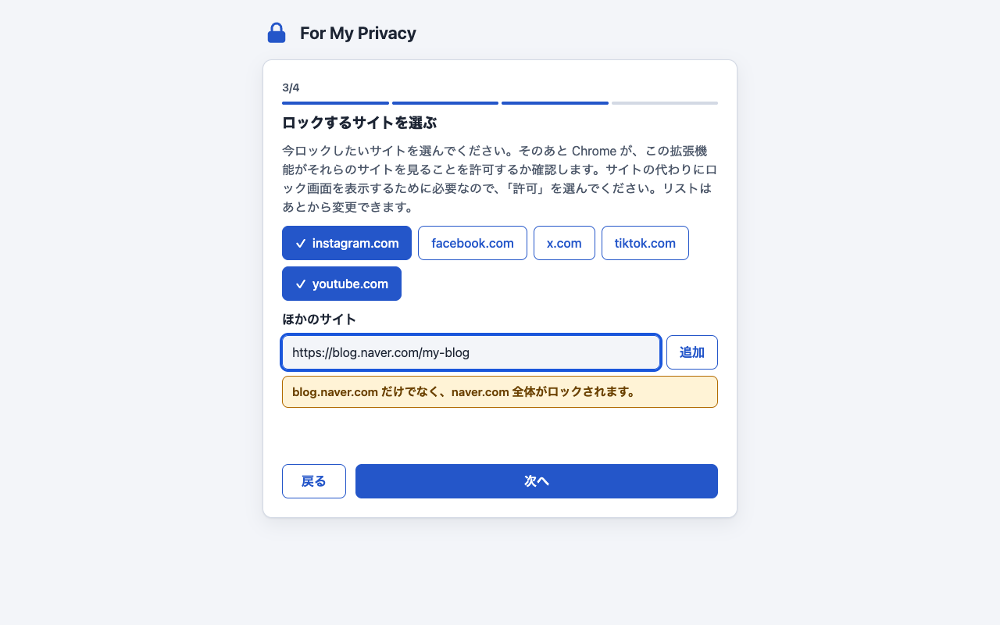
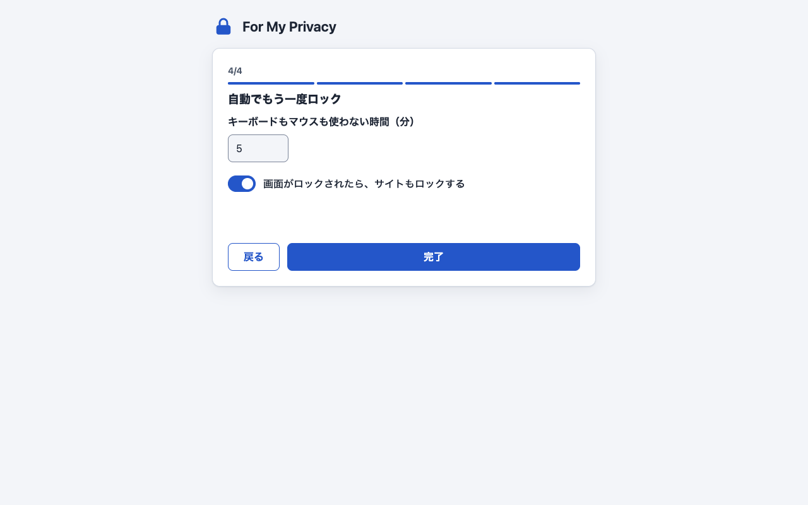
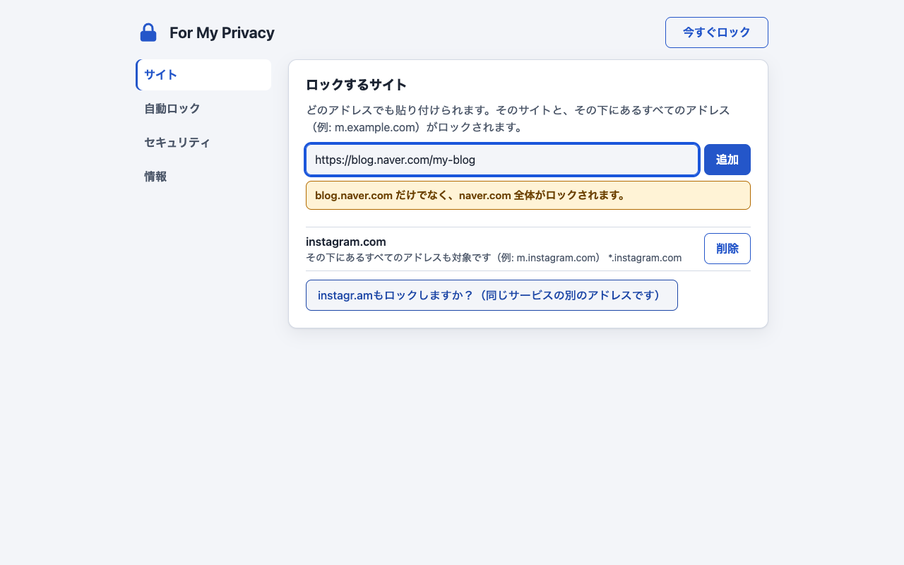
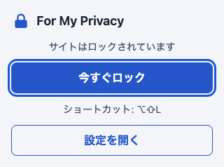
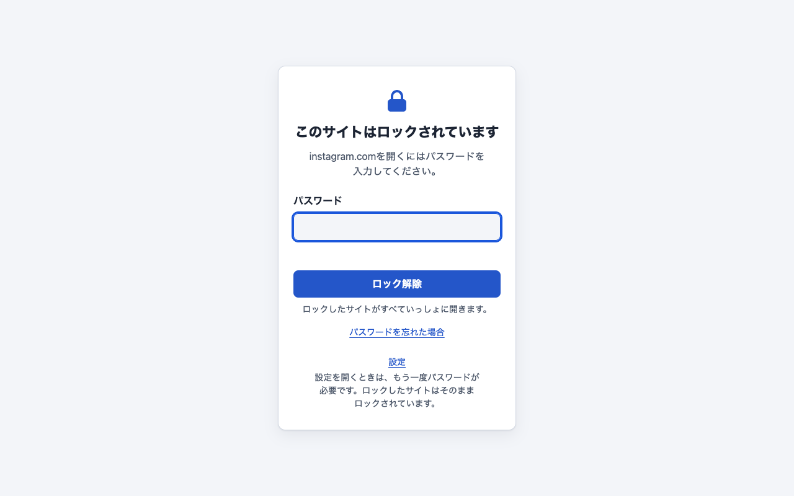
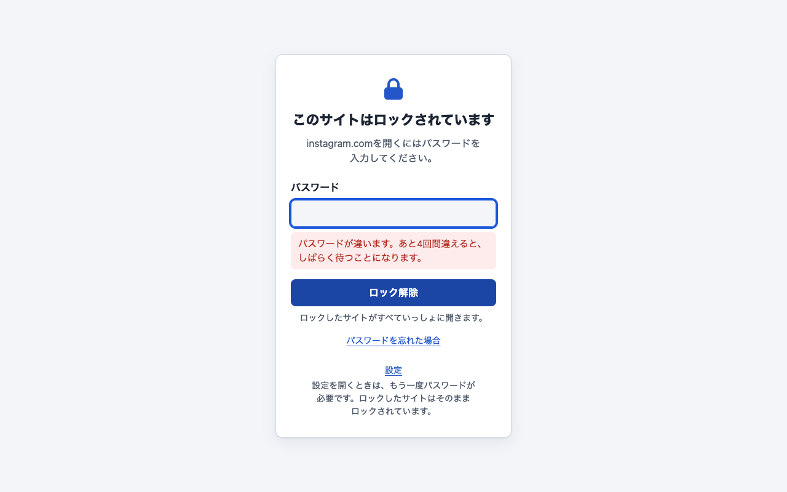
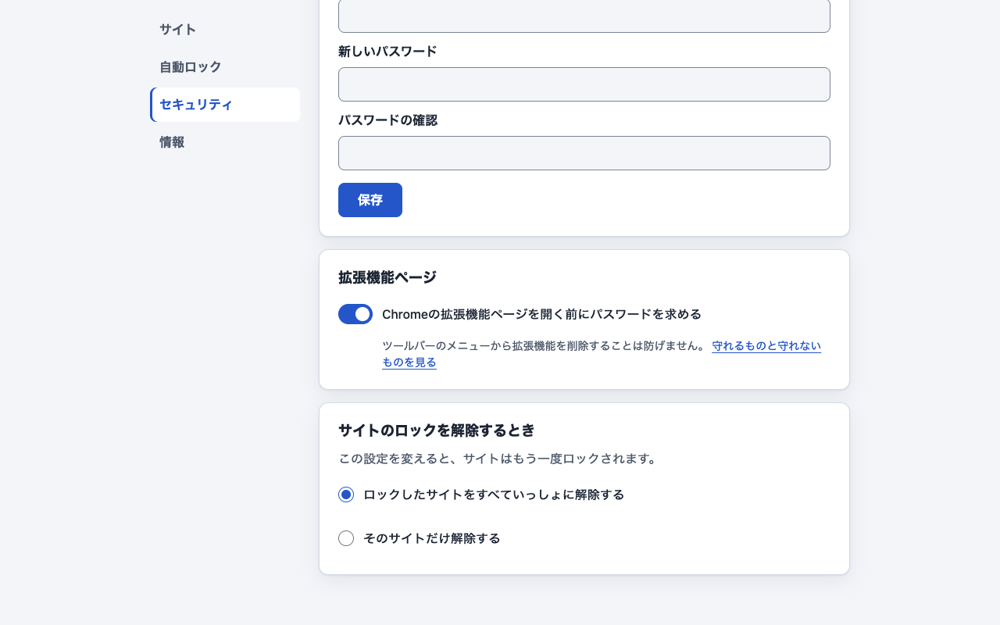

# For My Privacy：使い方ガイド

[English](usage.md) · [한국어](usage.ko.md) · **日本語**

> **状況：開発中、バージョン 0.1.0 の下書きです。** まだリリースはなく、Chrome ウェブストアにも公開していません。今はソースから自分でビルドして入れます（[インストール](#インストール)を参照）。このガイドは、このリポジトリのコードが今していることを説明します。

[README](../README.ja.md)に戻る。

## 目次

- [何をするものか](#何をするものか)
- [インストール](#インストール)
- [最初の起動](#最初の起動)
- [サイトの追加と削除](#サイトの追加と削除)
- [ロックする](#ロックする)
- [ロックを解除する](#ロックを解除する)
- [設定を見てまわる](#設定を見てまわる)
- [パスワードを忘れたとき、拡張機能を削除するとき](#パスワードを忘れたとき拡張機能を削除するとき)
- [守れるものと守れないもの](#守れるものと守れないもの)
- [よくある質問とトラブル対応](#よくある質問とトラブル対応)

## 何をするものか

- 選んだウェブサイトにパスワードをかけます。ロックされたサイトは、パスワードを入力するまで、ページの代わりにロック画面を表示します。
- 席を離れると自動でもう一度ロックされます。ワンクリックやキー1つで、すべてを一度にロックすることもできます。
- 想定しているのは、共用のパソコンや会社のパソコンから少し席を離れた間に、だれかがログインしたままの Chrome の前に座ってしまう場面です。

すべてあなたのパソコンの中だけにあります。アカウントも、ネットワーク通信も、解析ツールもありません。

## インストール

今のところ、ダウンロードできるファイルはありません。自分のパソコンで拡張機能を1回ビルドし、できたフォルダーを Chrome に読み込みます。5分ほどかかります。

### ソースからインストールする

[Git](https://git-scm.com/) と [Node.js](https://nodejs.org/) 22 以上が必要です。Chrome はバージョン 120 以上にしてください。

1. ターミナルを開きます。macOS ではターミナルアプリ、Windows では PowerShell かコマンドプロンプトを使います。
2. コードを取得してビルドします。

   ```sh
   git clone https://github.com/xcryptp/for-my-privacy.git
   cd for-my-privacy
   npm ci
   npm run build
   ```

   最後のコマンドがエラーなく終われば、ビルドは完了です。`for-my-privacy` の中に `.output/chrome-mv3` というフォルダーができます。
3. Chrome で `chrome://extensions` を開きます。
4. 右上の**デベロッパー モード**をオンにします。
5. **パッケージ化されていない拡張機能を読み込む**を押し、`.output/chrome-mv3` フォルダー（`manifest.json` が入っているフォルダー）を選びます。
6. 設定画面が自動で開き、最初のセットアップが始まります（[最初の起動](#最初の起動)を参照）。

補足：

- **macOS：** Finder は、名前がドットで始まるフォルダーを隠します。フォルダーを選ぶ画面で Command+Shift+.（ピリオド）を押すと `.output` が表示されます。
- **Windows：** `.output` はそのまま表示されます。
- **フォルダーはそのまま置いておいてください。** Chrome は起動のたびにこのフォルダーから拡張機能を読み込みます。フォルダーを移動したり削除したりすると、Chrome は拡張機能を読み込めなくなります。新しい場所から読み込み直すと、最初のセットアップがもう一度始まることがあります。
- **起動時のお知らせ。** Chrome を起動すると、デベロッパーモードの拡張機能についてのお知らせが出ます。この方法で読み込んだ拡張機能では正常です。
- **あとで更新するには：** 新しいコードを取得し、`npm ci` と `npm run build` をもう一度実行してから、`chrome://extensions` の拡張機能のカードで再読み込みのアイコンを押します。

### Chrome ウェブストア

まだありません。ストアに公開したら、ここでお知らせします。そのときはワンクリックでインストールできます。

### Chrome の権限のメッセージの意味

Chrome が拡張機能の権限を表示する場所（拡張機能の詳細、のちにはストアのページ）には、警告が2つ表示されます。

- **あらゆるページのコンテンツをブロック。** `declarativeNetRequest` 権限です。サイトへのアクセス権が外されてもロック対象のサイトをブロックし続けるために必要です。動作するのは、あなたが追加したサイトだけです。
- **Read your browsing history。** `tabs` と `webNavigation` の権限が共有する警告です。ロック対象のサイトを表示しているタブやフレームを見つけるために使います。それらのアドレスをロックするサイトの一覧と照らし合わせるだけで、どこにも送りません。

残りの権限（`storage`、`idle`、`browsingData`）には、Chrome は警告を表示しません。

**サイトへのアクセス許可**は別のもので、任意です。サイトを追加すると、Chrome がこの拡張機能にそのサイトへのアクセスを許可するかどうかを、1サイトずつ確認します。「許可」を選んでください。許可しないと、拡張機能はサイトの代わりにロック画面を表示できません。

## 最初の起動

拡張機能を初めて読み込むと、設定画面が開き、4ステップのセットアップが始まります。上にある 1/4 のような数字と進行バーが、今の位置を示します。

### ステップ1：ようこそ

拡張機能がすることが3行で書かれていて、防げないことへの**詳しく見る**リンクがあります。**始める**を押します。



### ステップ2：パスワードを作成

8文字以上のパスワードを入力し、**パスワードの確認**にもう一度入力して、**パスワードを作成**を押します。



この画面の警告を必ず読んでください。**このパスワードは復元できません。** 忘れた場合は、拡張機能を削除してもう一度インストールするしかなく、そのときロックしたサイトの一覧も消えます。忘れないパスワードを選び、安全な場所に控えておいてください。

2つの入力が違うと「パスワードが一致しません。」と表示され、短すぎると「8文字以上で入力してください。」と表示されます。

### ステップ3：ロックするサイトを選ぶ

今ロックしたいサイト（instagram.com、facebook.com、x.com、tiktok.com、youtube.com）を押します。押したサイトは選択済みの表示になります。ほかのサイトをロックするには、**ほかのサイト**に好きなウェブアドレスを貼り付けて**追加**を押します。入力欄の下の1行が、何がロックされるかを教えてくれます。アドレスを入力して**追加**を押さずに、そのまま**次へ**を押してもかまいません。



**次へ**を押します。何も選ばなかった場合、ボタンは**スキップ**になり、サイトはあとから追加できます。そのあと Chrome が、選んだサイトへのアクセス許可を求めます。「許可」を選んでください。許可しないと「Chromeがこのサイトへのアクセスを許可しなかったため、追加できませんでした。」と表示され、このステップのままになります。

### ステップ4：自動でもう一度ロック

キーボードもマウスも使わないまま何分たったら、もう一度ロックするかを決めます（1分から60分、初期値は5分）。**画面がロックされたら、サイトもロックする**のスイッチは、初期状態でオンです。**完了**を押します。



そのあと、設定画面の上のお知らせに、サイトがロックされたことと、ロックのショートカットキー（または決める場所）が表示されます。選んだサイトはすぐにロックされます。作ったばかりのパスワードでサイトが開くことはありません。新しいタブでそのサイトを開くと、ロック画面が表示されます。

> ステップ2とステップ4の間で画面を再読み込みしても、セットアップは途中から続き、**セットアップをスキップして設定へ**が表示されます。

## サイトの追加と削除

設定を開きます（[設定を見てまわる](#設定を見てまわる)を参照）。設定は**サイト**で開きます。



**追加するには。** **ロックするサイト**の下の入力欄に、サイトを入力するか、好きなウェブアドレスを貼り付けて、**追加**を押します。

- **どのアドレスでも使えます。** 拡張機能がアドレスをサイト全体にまとめます。Naver のブログのアドレスなら `naver.com` 全体が、Gmail のアドレスなら検索を含む `google.com` 全体がロックされます。ブログ1つやサイトの一部だけを単独でロックすることはできません。
- **その下にあるすべてのアドレスがロックされます。** 深さに関係なく、`instagram.com`、`www.instagram.com`、`help.instagram.com`、`a.b.instagram.com` のすべてです。`notinstagram.com` のように名前が似ているだけのサイトには手を出しません。`user.github.io` のように、みんなで共有しているアドレスは、それぞれ別のサイトとして扱います。
- **プレビューの行。** 入力欄の下の1行が、**追加**を押す前に、何がロックされるかを教えてくれます。`instagram.com` なら「instagram.com と、その下にあるすべてのアドレス（例: m.instagram.com）をロックします。」と表示されます。ブログのアドレスなら「blog.naver.com だけでなく、naver.com 全体がロックされます。」と表示されます。サイトのアドレスではない文字なら「example.com のようなサイトのアドレスを入力してください。」と表示されます。
- **おすすめ。** サービスによっては、一覧に「instagr.amもロックしますか？（同じサービスの別のアドレスです）」のようなボタンが出ます。押すと、そのアドレスも追加されます。
- **サイトへのアクセス許可。** サイトを追加すると、Chrome がアクセスの許可を求めます。「許可」を選んでください。許可しないと「Chromeがこのサイトへのアクセスを許可しなかったため、追加できませんでした。」と表示されます。

**削除するには。** そのサイトの行の**削除**を押します。そのサイトはすぐにロックされなくなります。拡張機能が求めていたサイトへのアクセス許可も、あわせて返します。

設定は、変えるとすぐに保存されます。「保存しました。」という短いお知らせが出ます。

## ロックする

手動でロックする方法が3つ、自動でロックされる場合が4つあります。ロックするときにパスワードは聞かれません。ロックすると、設定もロックされます。

### 手動でロックする

- **ツールバーのポップアップ。** Chrome のツールバーにある拡張機能のアイコンを押し、**今すぐロック**を押します。ポップアップに「ロックしました」と表示されて閉じます。セットアップが終わっていれば、タイトルの下の1行に「サイトはロックされています」または「ロックが解除されたサイトがあります」とも表示されます。アイコンが見えないときは、ツールバーのパズルのピースのアイコンを押し、先に For My Privacy を固定してください。

  

- **キーボードショートカット。** Alt+Shift+L を押します（Mac では Option+Shift+L）。ほかの拡張機能がすでに同じキーを使っていると、Chrome がショートカットを空けたままにすることがあります。ポップアップのボタンの下に、今設定されているキーが表示されます。設定や変更は、`chrome://extensions/shortcuts` を開いて、For My Privacy の**今すぐロック**にキーを割り当ててください。
- **設定から。** 設定画面の上にある**今すぐロック**のボタンも同じ働きをします。

### 自動でロックされる場合

- **使わない時間。** 決めた分数のあいだ、キーボードもマウスも使わなかったときです。Chrome の中だけでなく、パソコン全体の入力を数えます。
- **画面のロック。** **画面がロックされたら、サイトもロックする**がオンのとき、パソコンの画面がロックされるとロックされます。オフにすると、画面のロックだけではロックされませんが、画面がロックされている間も、使わない時間は数え続けます。
- **すべてのウィンドウを閉じたとき。** 最後の Chrome のウィンドウを閉じたときです。
- **Chrome を再起動したとき。** Chrome は、すべてロックされた状態で起動します。再起動や拡張機能の更新のあとに Chrome が復元したロック画面も、どのサイト用かを覚えているので、そこで解除するとそのサイトに移ります。

もう一度ロックされると、ロックされたサイトを開いていたタブはすべてロック画面に置き換わり、「戻る」を押しても前のページは戻ってきません。ロックされたサイトが開いた `blob:` ページや空の `about:blank` タブも、いっしょにロックされます。

ロックされたサイトをほかのページの中でだけ表示しているタブ（たとえば動画が埋め込まれたページ）は、代わりに再読み込みされます。そのタブ自身の「サイトを離れますか？」やフォーム再送信の確認が再読み込みを止めた場合は、拡張機能が約3秒後にタブを閉じ、同じアドレスで開き直します。そこで入力して保存していない内容は失われます。

## ロックを解除する

ロックされたサイトを開くか、そのサイトへのリンクを押すと、ページの代わりにロック画面が表示されます。ロック画面にはサイトの名前が出ますが、開こうとしたページは出ません。



パスワードを入力して**ロック解除**を押します。タブがそのサイトに移ります。ボタンの下の1行が、この解除で何が開くかを教えてくれます。

- **パスワードが違うとき。** しばらく待つことになるまでの残りの回数が表示されます。たとえば「パスワードが違います。あと4回間違えると、しばらく待つことになります。」と表示されます。

  

- **待ち時間のカウントダウン。** 続けて5回間違えると、次の入力までに待つ必要があります。最初の待ち時間は30秒で、そのあと間違えるたびに2倍になり、最大15分まで延びます。画面で残り時間が減っていきます。たとえば「パスワードの間違いが続きました。30秒後にもう一度お試しください。」と表示されます。この待ち時間は、設定とパスワードの変更にも同じように適用され、画面を再読み込みしても残ります。正しいパスワードを入力すると、回数は最初から数え直されます。
- **いっしょに解除するか、そのサイトだけ解除するか。** **設定 → セキュリティ**の**サイトのロックを解除するとき**には、2つの選択肢があります。
  - **ロックしたサイトをすべていっしょに解除する**（初期設定）。1回解除すると、ロックしたサイトすべてと Chrome の拡張機能ページが開きます。
  - **そのサイトだけ解除する。** ロック画面に表示されたサイトと、その下にあるすべてのアドレスだけが開きます。ほかのロックしたサイトはロックされたままです。Chrome の拡張機能ページは、そのページのロック画面で解除したときだけ開きます。

  

  この選択を変えると、サイトはすぐにもう一度ロックされます。設定は開いたままで、「保存しました。サイトはもう一度ロックされました。」と表示されます（拡張機能がまだロックを確認できていないときは、「保存しました。」だけです）。
- **ほかのロック画面のタブ。** もう一度ロックされたときにサイトのタブに代わって出たロック画面は、そのサイトが開く状態になると、自動でそのサイトに戻ります。ロックされたサイトを自分で開いて出たロック画面は、そのまま残ります。再読み込みすると、そのサイトが開く状態なら、サイトに移ります。「そのサイトだけ解除する」では、今解除したサイトのロック画面だけが戻ります。
- **戻る先がないとき。** タブに戻る先がない場合、ロック画面に「ロックを解除しました。サイトをもう一度開くことができます。」と表示されます（「そのサイトだけ解除する」で何も開かなかったときは「ここで開くものはありません。サイトをもう一度開いてください。」）。

解除した状態は、次にロックされるまで続きます。サイトを解除しても、設定は開きません（下を参照）。

## 設定を見てまわる

設定は、次のどれかで開きます。

- ロック画面で**設定**を押します。
- ツールバーのポップアップで**設定を開く**を押します。
- 拡張機能のアイコンを右クリックして**オプション**を選びます。

設定は、最初にパスワードを聞きます（「設定はロックされています」）。パスワードは同じですが、設定は別に解除する仕組みなので、サイトを解除しても設定は開かず、設定を開いてもサイトは開きません。そのため、サイトを1つ見るために少し解除しただけで、ロックするサイトの一覧を自由に変えられるようにはなりません。パスワードを作った直後は、設定が開いています。

設定画面は、そのタブが裏に回っている間、内容を隠します。タブに戻ると描き直され、保存していない入力途中のアドレスやパスワードは消えます。保存済みの設定は変わりません。

横のメニューに4つの項目があります。設定が開いている間は、いちばん上に**今すぐロック**があります。

| 項目 | 入っているもの |
| --- | --- |
| **サイト** | ロックしたサイトの一覧、追加の入力欄、おすすめ、そして一覧のサイトを Chrome が見られなくなったときに出る「サイトへのアクセス許可が取り消されました」のお知らせと**アクセスを許可**ボタン |
| **自動ロック** | **キーボードもマウスも使わない時間（分）** （1〜60、初期値は5）と、**画面がロックされたら、サイトもロックする**のスイッチ。1〜60の範囲外の数字は、いちばん近い使える値に変わり、お知らせが出ます |
| **セキュリティ** | **パスワードを変更**、**拡張機能ページ**、**サイトのロックを解除するとき**（上を参照） |
| **情報** | バージョンと、「守れるものと守れないもの」、プライバシーポリシー、GitHub のソースコードへのリンク |

**パスワードを変更**では、現在のパスワード、新しいパスワード（8文字以上）、新しいパスワードの確認を入力して、**保存**を押します。新しいパスワードも復元できません。

**拡張機能ページ。** **Chromeの拡張機能ページを開く前にパスワードを求める**のスイッチは、初期状態でオンです。ロック中に `chrome://extensions` を開くと、代わりに「Chrome の拡張機能ページはロックされています」というタイトルのロック画面が表示され、解除すると拡張機能ページに移ります。だれかがこっそり拡張機能をオフにするのを、しにくくします。ツールバーのメニューから拡張機能を削除することまでは防げません。このスイッチは `-noguard` ビルドにはありません。

## パスワードを忘れたとき、拡張機能を削除するとき

忘れたパスワードは復元できません。ロック画面と、ロックされた設定画面には、最初からやり直す方法を書いた**パスワードを忘れた場合**の案内があります。

1. Chrome のツールバーでパズルのピースのアイコンを押します。
2. For My Privacy の横にある三点メニューを押します。
3. 「Chrome から削除」を選びます。

パスワードとロックしたサイトの一覧が消えます。そのあと、拡張機能をもう一度読み込み（同じ `.output/chrome-mv3` フォルダー、[インストール](#インストール)を参照）、[最初の起動](#最初の起動)をもう一度行ってください。`chrome://extensions` の拡張機能のカードにある**削除**ボタンで削除することもできます。

あなたのパソコンで Chrome を使える人なら、だれでも同じ方法で削除できます。次の項目を見てください。

## 守れるものと守れないもの

席を離れている間に、ログインしたままの Chrome の前に座った人が、ロックしたサイトを開くのを防ぐために作りました。パソコンを自由に操作できる人や、Chrome のデベロッパーツールを知っている人は防げません。ツールバーのメニューから拡張機能を削除すること、拡張機能をオフにして Chrome を起動すること、Chrome の履歴に残るページのタイトルも守れません。

全体の一覧と、それぞれの対策は、README の[何を守り何を守れないか](../README.ja.md#何を守り何を守れないか)にあります。

## よくある質問とトラブル対応

**ロック画面が出ずにサイトが開きました。**
- **設定 → サイト**の一覧にあるか確認してください。同じサービスの別のアドレスは別のサイトです。`youtu.be` は、いっしょに追加しない限り `youtube.com` とは別です。
- そのサイトが今ロックされているか確認してください。1回解除すると、次にロックされるまで開いたままです。
- **サイト**に「サイトへのアクセス許可が取り消されました」のお知らせがないか見てください。あれば**アクセスを許可**を押します。
- シークレットウィンドウとゲストウィンドウは守れません。そこでは拡張機能が初期状態でオフです。

**ロック画面の前に Chrome のブロック画面が出ます。** サイトへのアクセス許可が外されています（たとえばツールバーのメニューから）。サイトはブロックされたままですが、Chrome が自分の画面を一瞬先に出すことがあります。**設定 → サイト**を開いて**アクセスを許可**を押してください。

**ショートカットを押しても何も起きません。** ほかの拡張機能が同じキーを使っていて、Chrome がショートカットを空けたままにしているのかもしれません。`chrome://extensions/shortcuts` を開いて、For My Privacy の**今すぐロック**にキーを割り当ててください。ポップアップに今設定されているキーが表示されます。

**拡張機能のアイコンが見つかりません。** Chrome のツールバーのパズルのピースのアイコンを押し、For My Privacy を固定してください。

**ポップアップに「先に設定でセットアップを完了してください。」と出ます。** まだパスワードがありません。設定を開いて、最初のセットアップを終えてください。

**サイトがひとりでにもう一度ロックされました。** 使わない時間、画面のロック、すべてのウィンドウを閉じること、Chrome の再起動、**今すぐロック**のどれかがロックしました。あまり頻繁なら、**設定 → 自動ロック**で分数を増やしてください。

**ロック解除ボタンがグレーで、時間が減っていきます。** 5回間違えました。カウントダウンが終わるまで待ってください。飛ばすことはできません。設定とパスワードの変更にも同じ待ち時間が適用されます。

**ロック解除を押しても何も起きない、または拡張機能が更新されたというお知らせが出ます。** 拡張機能のフォルダーを入れ替えた（またはビルドし直した）のに、Chrome は古いバージョンを読み込んだままです。`chrome://extensions` を開いて For My Privacy の再読み込みアイコンを押し、ページを再読み込みしてからもう一度お試しください。

**フォルダーを移動または削除したら、Chrome が拡張機能を読み込めません。** 必要ならもう一度ビルドして、**パッケージ化されていない拡張機能を読み込む**でフォルダーを読み込み直してください。Chrome が新しい拡張機能として扱うことがあり、最初のセットアップがもう一度始まることがあります。

**Chrome の起動時にデベロッパーモードの拡張機能のお知らせが出ます。** パッケージ化されていない拡張機能では正常です。
