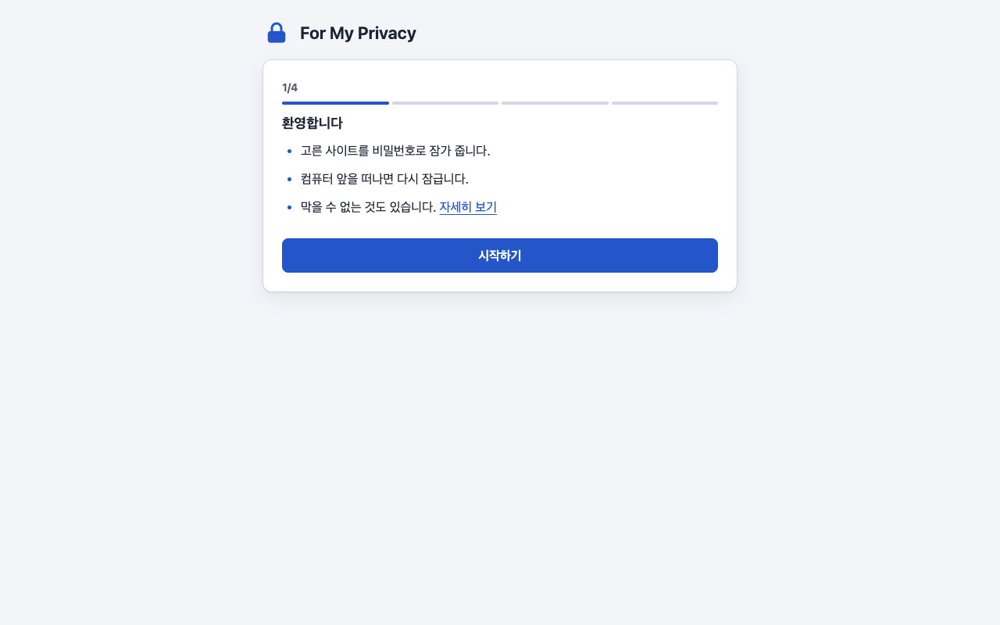
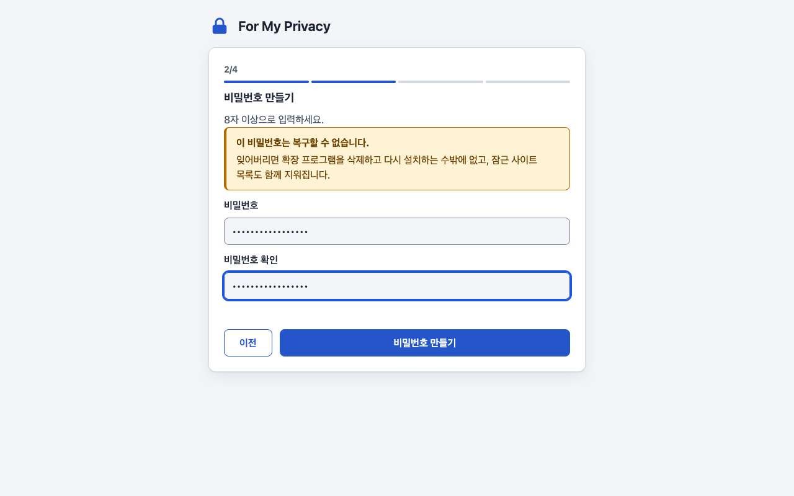
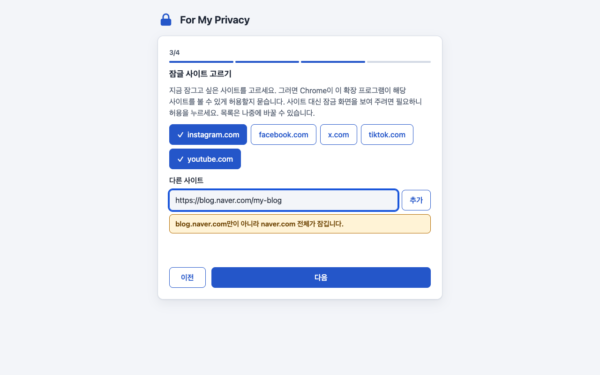
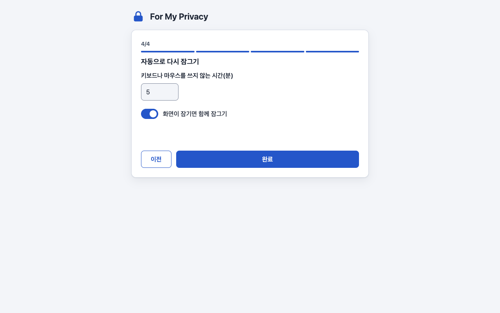
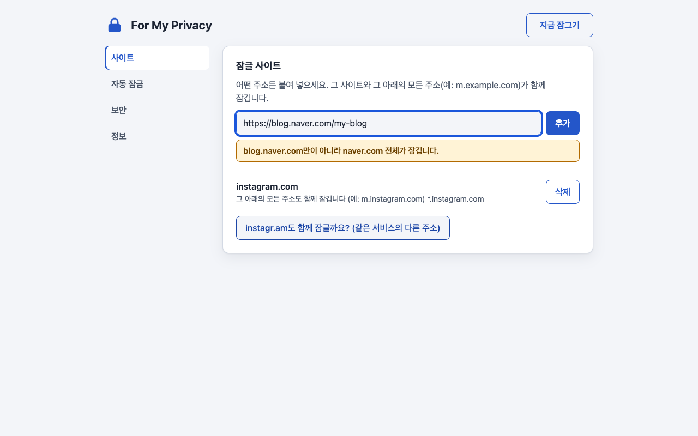
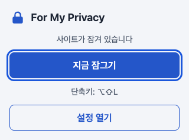
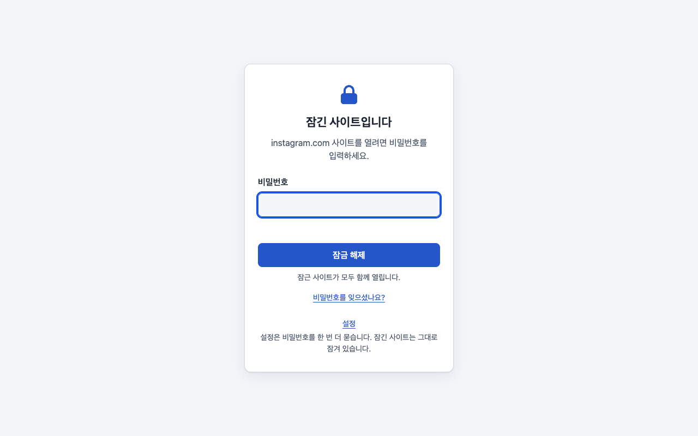
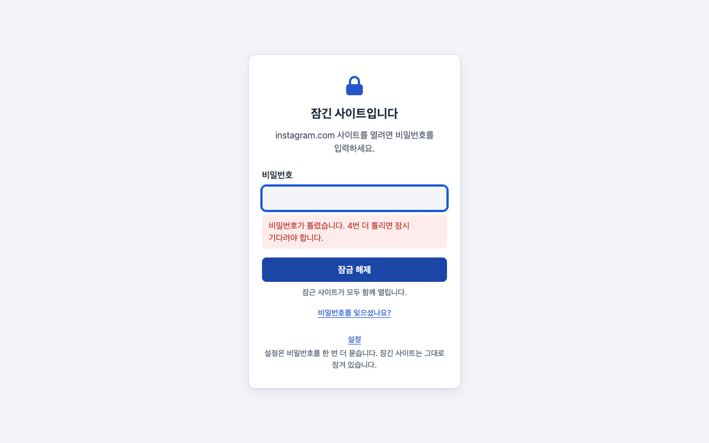
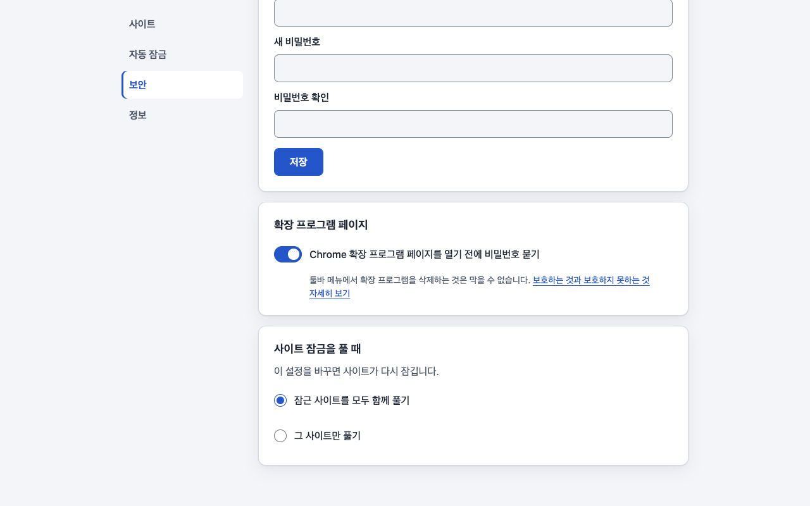

# For My Privacy: 사용 설명서

[English](usage.md) · **한국어** · [日本語](usage.ja.md)

> **상태: 개발 중, 0.1.0 초안입니다.** 아직 릴리스가 없고 크롬 웹 스토어에도 올라 있지 않습니다. 지금은 소스에서 직접 빌드해 설치합니다([설치](#설치) 참고). 이 설명서는 이 저장소의 코드가 지금 하는 일을 설명합니다.

[README](../README.ko.md)로 돌아가기.

## 목차

- [무슨 일을 하나요](#무슨-일을-하나요)
- [설치](#설치)
- [처음 실행](#처음-실행)
- [사이트 추가와 삭제](#사이트-추가와-삭제)
- [잠그기](#잠그기)
- [잠금 풀기](#잠금-풀기)
- [설정 둘러보기](#설정-둘러보기)
- [비밀번호를 잊었을 때, 확장 프로그램을 지울 때](#비밀번호를-잊었을-때-확장-프로그램을-지울-때)
- [무엇을 지키고 무엇은 지키지 못하나](#무엇을-지키고-무엇은-지키지-못하나)
- [자주 묻는 질문과 문제 해결](#자주-묻는-질문과-문제-해결)

## 무슨 일을 하나요

- 고른 웹사이트에 비밀번호를 겁니다. 잠긴 사이트는 비밀번호를 입력하기 전까지 페이지 대신 잠금 화면을 보여 줍니다.
- 자리를 비우면 저절로 다시 잠기고, 클릭 한 번이나 키 하나로 전부 한꺼번에 잠글 수도 있습니다.
- 이런 상황을 위해 만들었습니다. 여럿이 쓰는 컴퓨터나 회사 컴퓨터에서 잠깐 자리를 비운 사이에 누군가 로그인된 크롬 앞에 앉을 수 있는 상황입니다.

모든 것은 내 컴퓨터 안에만 있습니다. 계정도, 네트워크 요청도, 분석 도구도 없습니다.

## 설치

지금은 내려받을 파일이 없습니다. 내 컴퓨터에서 확장 프로그램을 한 번 빌드하고, 만들어진 폴더를 크롬에 불러옵니다. 5분 정도 걸립니다.

### 소스에서 설치하기

[Git](https://git-scm.com/)과 [Node.js](https://nodejs.org/) 22 이상이 필요합니다. 크롬은 120 버전 이상이어야 합니다.

1. 터미널을 엽니다. macOS에서는 터미널 앱, Windows에서는 PowerShell이나 명령 프롬프트를 쓰면 됩니다.
2. 코드를 받아 빌드합니다.

   ```sh
   git clone https://github.com/xcryptp/for-my-privacy.git
   cd for-my-privacy
   npm ci
   npm run build
   ```

   마지막 명령이 오류 없이 끝나면 빌드가 끝난 것입니다. `for-my-privacy` 안에 `.output/chrome-mv3` 폴더가 만들어집니다.
3. 크롬에서 `chrome://extensions`를 엽니다.
4. 오른쪽 위의 **개발자 모드**를 켭니다.
5. **압축해제된 확장 프로그램을 로드합니다**를 누르고 `.output/chrome-mv3` 폴더(`manifest.json`이 들어 있는 폴더)를 고릅니다.
6. 설정 화면이 저절로 열리고 처음 설정이 시작됩니다([처음 실행](#처음-실행) 참고).

참고:

- **macOS:** Finder는 이름이 점으로 시작하는 폴더를 숨깁니다. 폴더 선택 창에서 Command+Shift+.(마침표)를 누르면 `.output`이 보입니다.
- **Windows:** `.output`은 그대로 보입니다.
- **폴더를 그 자리에 두세요.** 크롬은 켤 때마다 이 폴더에서 확장 프로그램을 읽습니다. 폴더를 옮기거나 지우면 크롬이 확장 프로그램을 더 이상 불러올 수 없고, 새 위치에서 다시 불러오면 처음 설정이 다시 시작될 수 있습니다.
- **시작할 때 뜨는 안내.** 크롬을 켜면 개발자 모드 확장 프로그램에 대한 안내가 뜹니다. 이렇게 불러온 확장 프로그램에서는 정상입니다.
- **나중에 업데이트하기:** 새 코드를 받아 `npm ci`와 `npm run build`를 다시 실행한 뒤, `chrome://extensions`의 확장 프로그램 카드에서 새로고침 아이콘을 누릅니다.

### 크롬 웹 스토어

아직 없습니다. 스토어에 올라가면 이곳에 알리겠습니다. 그때는 클릭 한 번으로 설치할 수 있습니다.

### 크롬의 권한 안내는 무슨 뜻인가요

크롬이 확장 프로그램의 권한을 보여 주는 곳(확장 프로그램 세부정보, 나중에는 스토어 페이지)에는 경고가 두 가지 보입니다.

- **모든 페이지의 콘텐츠 차단.** `declarativeNetRequest` 권한입니다. 사이트 접근 권한이 빠져도 잠긴 사이트를 막으려면 필요합니다. 내가 추가한 사이트에만 동작합니다.
- **Read your browsing history.** `tabs`와 `webNavigation` 권한이 함께 쓰는 경고입니다. 잠긴 사이트를 보여 주는 탭과 프레임을 찾는 데 쓰입니다. 그 주소를 잠글 사이트 목록과 견줄 뿐, 어디로도 보내지 않습니다.

나머지 권한(`storage`, `idle`, `browsingData`)에는 크롬이 경고를 띄우지 않습니다.

**사이트 접근 권한**은 따로이며 선택 사항입니다. 사이트를 추가하면 크롬이 이 확장 프로그램이 그 사이트에 접근하도록 허용할지 한 곳씩 묻습니다. 허용을 누르세요. 허용하지 않으면 확장 프로그램이 사이트 대신 잠금 화면을 보여 줄 수 없습니다.

## 처음 실행

확장 프로그램을 처음 불러오면 설정 화면이 열리고 4단계 준비가 시작됩니다. 위쪽의 1/4 같은 숫자와 진행 막대가 지금 어디인지 알려 줍니다.

### 1단계: 환영합니다

이 확장 프로그램이 하는 일이 세 줄로 나오고, 막을 수 없는 것으로 가는 **자세히 보기** 링크가 있습니다. **시작하기**를 누르세요.



### 2단계: 비밀번호 만들기

8자 이상의 비밀번호를 입력하고, **비밀번호 확인**에 한 번 더 입력한 뒤 **비밀번호 만들기**를 누르세요.



이 화면의 경고를 꼭 읽으세요. **이 비밀번호는 복구할 수 없습니다.** 잊어버리면 확장 프로그램을 삭제하고 다시 설치하는 수밖에 없고, 그러면 잠근 사이트 목록도 함께 지워집니다. 잊지 않을 비밀번호를 고르고, 안전한 곳에 적어 두세요.

두 입력이 다르면 "비밀번호가 서로 다릅니다."라고 나오고, 너무 짧으면 "8자 이상으로 입력하세요."라고 나옵니다.

### 3단계: 잠글 사이트 고르기

지금 잠그고 싶은 사이트(instagram.com, facebook.com, x.com, tiktok.com, youtube.com)를 누르세요. 누른 사이트는 선택된 것으로 표시됩니다. 다른 사이트를 잠그려면 **다른 사이트**에 아무 웹 주소나 붙여 넣고 **추가**를 누르세요. 입력란 아래 한 줄이 무엇이 잠기는지 알려 줍니다. 주소를 입력하고 **추가**를 누르지 않은 채 **다음**을 눌러도 됩니다.



**다음**을 누르세요. 아무것도 고르지 않았다면 버튼이 **건너뛰기**로 바뀌며, 사이트는 나중에 추가할 수 있습니다. 이어서 크롬이 고른 사이트에 대한 접근 허용을 묻습니다. 허용을 누르세요. 허용하지 않으면 "Chrome에서 이 사이트에 대한 접근을 허용하지 않아 추가하지 못했습니다."라고 나오고 이 단계에 머뭅니다.

### 4단계: 자동으로 다시 잠그기

키보드나 마우스를 쓰지 않은 채 컴퓨터를 두면 몇 분 뒤에 다시 잠글지 정하세요(1분에서 60분, 기본 5분). **화면이 잠기면 함께 잠그기** 스위치는 기본으로 켜져 있습니다. **완료**를 누르세요.



완료하면 설정 화면 위쪽의 안내에 사이트가 잠겼다는 말과 함께 잠그기 단축키가 나오거나, 단축키를 정하는 곳이 나옵니다. 고른 사이트는 바로 잠깁니다. 방금 만든 비밀번호로 사이트가 열리지는 않습니다. 새 탭에서 그 사이트를 열면 잠금 화면이 보입니다.

> 2단계와 4단계 사이에 화면을 새로고침해도 준비는 하던 곳에서 이어지며, **준비를 건너뛰고 설정으로 가기**가 나타납니다.

## 사이트 추가와 삭제

설정을 엽니다([설정 둘러보기](#설정-둘러보기) 참고). 설정은 **사이트** 메뉴에서 열립니다.



**추가하기.** **잠글 사이트** 아래 입력란에 사이트를 입력하거나 아무 웹 주소나 붙여 넣고 **추가**를 누르세요.

- **어떤 주소든 됩니다.** 확장 프로그램이 주소를 사이트 전체로 줄여 줍니다. 네이버 블로그 주소를 넣으면 `naver.com` 전체가, Gmail 주소를 넣으면 검색을 포함한 `google.com` 전체가 잠깁니다. 블로그 하나나 사이트의 일부만 따로 잠글 수는 없습니다.
- **그 아래의 모든 주소가 잠깁니다.** 깊이에 상관없이 `instagram.com`, `www.instagram.com`, `help.instagram.com`, `a.b.instagram.com`이 모두 잠깁니다. `notinstagram.com`처럼 이름만 비슷한 사이트는 건드리지 않습니다. `user.github.io`처럼 여러 사람이 나눠 쓰는 주소는 각각 별개의 사이트로 칩니다.
- **미리 보기 줄.** 입력란 아래 한 줄이, **추가**를 누르기 전에 무엇이 잠기는지 알려 줍니다. `instagram.com`이면 "잠길 사이트: instagram.com (그 아래의 모든 주소 포함, 예: m.instagram.com)"이라고 나옵니다. 블로그 주소이면 "blog.naver.com만이 아니라 naver.com 전체가 잠깁니다."라고 나옵니다. 사이트 주소가 아닌 글자이면 "example.com 같은 사이트 주소를 입력하세요."라고 나옵니다.
- **추천.** 일부 서비스는 목록에 "instagr.am도 함께 잠글까요? (같은 서비스의 다른 주소)" 같은 버튼이 나옵니다. 누르면 그 주소도 추가됩니다.
- **사이트 접근 권한.** 사이트를 추가하면 크롬이 접근 허용을 묻습니다. 허용을 누르세요. 허용하지 않으면 "Chrome에서 이 사이트에 대한 접근을 허용하지 않아 추가하지 못했습니다."라고 나옵니다.

**삭제하기.** 그 사이트 줄의 **삭제**를 누르세요. 그 사이트는 바로 잠기지 않게 됩니다. 확장 프로그램이 요청했던 사이트 접근 권한도 함께 돌려줍니다.

설정은 바꾸는 즉시 저장되며, "저장되었습니다."라는 짧은 안내가 나옵니다.

## 잠그기

직접 잠그는 방법이 세 가지, 자동으로 잠기는 경우가 네 가지 있습니다. 잠글 때는 비밀번호를 묻지 않습니다. 잠그면 설정도 함께 잠깁니다.

### 직접 잠그기

- **툴바 팝업.** 크롬 툴바의 확장 프로그램 아이콘을 누르고 **지금 잠그기**를 누르세요. 팝업에 "잠갔습니다"라고 나오고 닫힙니다. 준비가 끝난 뒤에는 제목 아래 한 줄에 "사이트가 잠겨 있습니다" 또는 "잠금이 풀린 사이트가 있습니다"도 나옵니다. 아이콘이 보이지 않으면 툴바의 퍼즐 조각 아이콘을 누르고 For My Privacy를 먼저 고정하세요.

  

- **키보드 단축키.** Alt+Shift+L을 누르세요(Mac에서는 Option+Shift+L). 다른 확장 프로그램이 이미 같은 키를 쓰고 있으면 크롬이 단축키를 비워 둘 수 있습니다. 팝업의 버튼 아래에 지금 설정된 키가 표시됩니다. 설정하거나 바꾸려면 `chrome://extensions/shortcuts`를 열어 For My Privacy의 **지금 잠그기**에 키를 지정하세요.
- **설정에서.** 설정 화면 맨 위의 **지금 잠그기** 버튼도 같은 일을 합니다.

### 자동으로 잠기는 경우

- **쓰지 않은 시간.** 정해 둔 분 동안 키보드나 마우스를 쓰지 않았을 때입니다. 크롬 안만이 아니라 컴퓨터 전체의 입력을 셉니다.
- **화면 잠금.** **화면이 잠기면 함께 잠그기**가 켜져 있을 때 컴퓨터 화면이 잠기면 잠깁니다. 끄면 화면 잠금만으로는 잠기지 않지만, 화면이 잠겨 있는 동안에도 쓰지 않은 시간은 계속 셉니다.
- **모든 창 닫기.** 마지막 크롬 창을 닫았을 때입니다.
- **크롬 다시 시작.** 크롬은 모두 잠긴 채로 시작합니다. 크롬을 다시 시작하거나 확장 프로그램을 업데이트한 뒤 크롬이 되살린 잠금 화면도 어느 사이트용인지 그대로 알고 있어서, 거기서 풀면 그 사이트로 갑니다.

다시 잠기면 잠긴 사이트가 열려 있던 탭은 모두 잠금 화면으로 바뀌고, 뒤로 가기를 눌러도 이전 페이지가 돌아오지 않습니다. 잠긴 사이트가 연 `blob:` 페이지나 빈 `about:blank` 탭도 함께 잠깁니다.

잠긴 사이트를 다른 페이지 안에만 보여 주는 탭(예: 영상이 삽입된 페이지)은 대신 새로 고쳐집니다. 그 탭 자체의 "사이트를 나가시겠습니까?"나 양식 다시 제출 질문이 새로 고침을 붙잡으면, 확장 프로그램이 약 3초 뒤에 탭을 닫고 같은 주소로 다시 엽니다. 거기에 입력하고 저장하지 않은 내용은 사라집니다.

## 잠금 풀기

잠긴 사이트를 열거나 그 사이트의 링크를 누르면 페이지 대신 잠금 화면이 나옵니다. 잠금 화면에는 사이트 이름이 나오지만, 열려던 페이지는 나오지 않습니다.



비밀번호를 입력하고 **잠금 해제**를 누르세요. 탭이 그 사이트로 넘어갑니다. 버튼 아래의 한 줄이 이 잠금 해제로 무엇이 열리는지 알려 줍니다.

- **비밀번호가 틀렸을 때.** 잠시 기다리기 전까지 남은 횟수가 나옵니다. 예를 들어 "비밀번호가 틀렸습니다. 4번 더 틀리면 잠시 기다려야 합니다."라고 나옵니다.

  

- **기다리는 시간 표시.** 연달아 5번 틀리면 다음 시도 전에 기다려야 합니다. 첫 대기는 30초이고, 그 뒤로 틀릴 때마다 두 배가 되어 최대 15분까지 늘어납니다. 화면에 남은 시간이 줄어듭니다. 예를 들어 "비밀번호를 여러 번 틀렸습니다. 30초 후에 다시 시도하세요."라고 나옵니다. 이 대기는 설정과 비밀번호 변경에도 똑같이 적용되고, 화면을 새로고침해도 그대로 남아 있습니다. 비밀번호를 맞히면 횟수가 처음부터 다시 셉니다.
- **모두 함께 풀기, 또는 그 사이트만 풀기.** **설정 → 보안**의 **사이트 잠금을 풀 때**에는 두 가지가 있습니다.
  - **잠근 사이트를 모두 함께 풀기**(기본값). 한 번 풀면 잠긴 사이트 전체와 크롬 확장 프로그램 페이지가 열립니다.
  - **그 사이트만 풀기.** 잠금 화면에 나온 사이트와 그 아래의 모든 주소만 열립니다. 다른 잠긴 사이트는 그대로 잠겨 있습니다. 크롬 확장 프로그램 페이지는 그 페이지의 잠금 화면에서 풀어야만 열립니다.

  

  이 선택을 바꾸면 사이트가 바로 다시 잠깁니다. 설정은 열린 채로 있고 "저장되었습니다. 사이트가 다시 잠겼습니다."라고 나옵니다(확장 프로그램이 아직 잠금을 확인하지 못했다면 "저장되었습니다."만 나옵니다).
- **다른 잠금 탭.** 다시 잠길 때 사이트 탭을 대신한 잠금 화면은, 그 사이트가 열리면 저절로 그 사이트로 돌아갑니다. 잠긴 사이트를 직접 방문해서 만난 잠금 화면은 그대로 남습니다. 새로고침하면 그 사이트가 열려 있을 때 사이트로 넘어갑니다. "그 사이트만 풀기"에서는 방금 푼 사이트의 잠금 화면만 돌아갑니다.
- **돌아갈 곳이 없을 때.** 탭이 돌아갈 곳이 없으면 잠금 화면에 "잠금이 해제되었습니다. 이제 사이트를 다시 열 수 있습니다."라고 나옵니다("그 사이트만 풀기"에서 열린 것이 없을 때는 "여기서 열 사이트가 없습니다. 사이트를 다시 열어 주세요.").

푼 상태는 다음에 잠글 때까지 이어집니다. 사이트를 푼다고 설정이 열리지는 않습니다(아래 참고).

## 설정 둘러보기

설정은 다음 중 하나로 엽니다.

- 잠금 화면에서 **설정**을 누릅니다.
- 툴바 팝업에서 **설정 열기**를 누릅니다.
- 확장 프로그램 아이콘을 우클릭해 **옵션**을 고릅니다.

설정은 먼저 비밀번호를 묻습니다("설정이 잠겨 있습니다"). 비밀번호는 같지만 설정은 따로 풀게 되어 있어서, 사이트를 풀어도 설정이 열리지 않고 설정을 열어도 사이트는 열리지 않습니다. 그래서 사이트 하나를 보려고 잠깐 푼 것만으로 잠글 사이트 목록을 마음대로 바꿀 수 있게 되지는 않습니다. 비밀번호를 막 만든 직후에는 설정이 열려 있습니다.

설정 화면은 그 탭이 뒤로 가 있는 동안 내용을 숨기기도 합니다. 그 탭으로 돌아오면 다시 그려지고, 저장하지 않은 채 입력하던 주소나 비밀번호는 지워집니다. 저장된 설정은 그대로입니다.

옆의 메뉴에 네 가지가 있습니다. 설정이 열려 있는 동안에는 맨 위에 **지금 잠그기**가 있습니다.

| 메뉴 | 들어 있는 것 |
| --- | --- |
| **사이트** | 잠근 사이트 목록, 추가 입력란, 추천, 그리고 목록의 사이트를 크롬이 더는 볼 수 없게 되면 나오는 "사이트 접근 권한이 사라졌습니다" 안내와 **접근 권한 허용** 버튼 |
| **자동 잠금** | **키보드나 마우스를 쓰지 않는 시간(분)** (1에서 60, 기본 5)과 **화면이 잠기면 함께 잠그기** 스위치. 1에서 60을 벗어난 숫자는 가장 가까운 허용 값으로 바뀌고 안내가 나옵니다 |
| **보안** | **비밀번호 변경**, **확장 프로그램 페이지**, **사이트 잠금을 풀 때**(위 참고) |
| **정보** | 버전, 그리고 "보호하는 것과 보호하지 못하는 것", 개인정보 처리방침, GitHub 소스 코드 링크 |

**비밀번호 변경**은 현재 비밀번호, 새 비밀번호(8자 이상), 새 비밀번호 확인을 입력하고 **저장**을 누릅니다. 새 비밀번호도 복구할 수 없습니다.

**확장 프로그램 페이지.** **Chrome 확장 프로그램 페이지를 열기 전에 비밀번호 묻기** 스위치는 기본으로 켜져 있습니다. 잠겨 있을 때 `chrome://extensions`를 열면 "Chrome 확장 프로그램 페이지가 잠겨 있습니다"라는 제목의 잠금 화면이 대신 나오고, 풀고 나면 확장 프로그램 페이지로 갑니다. 누군가 몰래 확장 프로그램을 끄기 어렵게 해 줍니다. 툴바 메뉴에서 확장 프로그램을 삭제하는 것까지 막지는 못합니다. 이 스위치는 `-noguard` 빌드에는 없습니다.

## 비밀번호를 잊었을 때, 확장 프로그램을 지울 때

잊어버린 비밀번호는 복구할 수 없습니다. 잠금 화면과 잠긴 설정 화면에는 처음부터 다시 하는 방법을 알려 주는 **비밀번호를 잊으셨나요?** 안내가 있습니다.

1. 크롬 툴바의 퍼즐 조각 아이콘을 누릅니다.
2. For My Privacy 옆의 점 세 개 메뉴를 누릅니다.
3. "Chrome에서 삭제"를 고릅니다.

비밀번호와 잠근 사이트 목록이 지워집니다. 그다음 확장 프로그램을 다시 불러오고(같은 `.output/chrome-mv3` 폴더, [설치](#설치) 참고) [처음 실행](#처음-실행)을 다시 거치세요. `chrome://extensions`의 확장 프로그램 카드에서 **삭제** 버튼으로 지워도 됩니다.

내 컴퓨터에서 크롬을 쓸 수 있는 사람은 누구나 같은 방법으로 지울 수 있습니다. 다음 항목을 보세요.

## 무엇을 지키고 무엇은 지키지 못하나

내가 자리를 비운 사이에 로그인된 크롬 앞에 앉은 사람이 잠가 둔 사이트를 여는 것을 막도록 만들었습니다. 컴퓨터를 마음대로 다룰 수 있는 사람이나 크롬 개발자 도구를 아는 사람은 막지 못합니다. 툴바 메뉴에서 확장 프로그램을 삭제하는 것, 확장 프로그램을 끄고 크롬을 실행하는 것, 크롬 방문 기록에 남는 페이지 제목도 지키지 못합니다.

전체 목록과 각각의 대비책은 README의 [무엇을 막고 무엇은 막지 못하나](../README.ko.md#무엇을-막고-무엇은-막지-못하나)에 있습니다.

## 자주 묻는 질문과 문제 해결

**사이트가 잠금 화면 없이 열렸습니다.**
- **설정 → 사이트** 목록에 있는지 확인하세요. 같은 서비스의 다른 주소는 다른 사이트입니다. `youtu.be`는 함께 추가하지 않으면 `youtube.com`과 별개입니다.
- 지금 그 사이트가 잠겨 있는지 확인하세요. 한 번 풀면 다음에 잠글 때까지 열려 있습니다.
- **사이트** 메뉴에 "사이트 접근 권한이 사라졌습니다" 안내가 있는지 보세요. 있다면 **접근 권한 허용**을 누르세요.
- 시크릿 창과 게스트 창은 지키지 못하며, 그곳에서는 확장 프로그램이 기본으로 꺼져 있습니다.

**잠금 화면보다 크롬의 차단 화면이 먼저 보입니다.** 사이트 접근 권한이 빠졌습니다(예: 툴바 메뉴에서). 사이트는 계속 막혀 있지만, 크롬이 자기 화면을 잠깐 먼저 보여 줄 수 있습니다. **설정 → 사이트**를 열고 **접근 권한 허용**을 누르세요.

**단축키를 눌러도 아무 일도 없습니다.** 다른 확장 프로그램이 같은 키를 써서 크롬이 단축키를 비워 뒀을 수 있습니다. `chrome://extensions/shortcuts`를 열어 For My Privacy의 **지금 잠그기**에 키를 지정하세요. 팝업에 지금 설정된 키가 표시됩니다.

**확장 프로그램 아이콘이 보이지 않습니다.** 크롬 툴바의 퍼즐 조각 아이콘을 누르고 For My Privacy를 고정하세요.

**팝업에 "먼저 설정에서 준비를 끝내 주세요."라고 나옵니다.** 아직 비밀번호가 없습니다. 설정을 열어 처음 설정을 마치세요.

**사이트가 저절로 다시 잠겼습니다.** 쓰지 않은 시간, 화면 잠금, 모든 창 닫기, 크롬 다시 시작, **지금 잠그기** 중 하나가 잠근 것입니다. 너무 자주 잠기면 **설정 → 자동 잠금**에서 분을 늘리세요.

**잠금 해제 버튼이 회색이고 시간이 줄어듭니다.** 5번 틀렸습니다. 시간이 끝날 때까지 기다리세요. 건너뛸 수 없습니다. 설정과 비밀번호 변경에도 같은 대기가 적용됩니다.

**잠금 해제를 눌러도 반응이 없거나 확장 프로그램이 업데이트되었다는 안내가 나옵니다.** 확장 프로그램 폴더를 바꾸거나 다시 빌드했는데 크롬에는 이전 버전이 그대로 불러와진 상태입니다. `chrome://extensions`를 열어 For My Privacy의 새로고침 아이콘을 누른 뒤, 페이지를 새로고침하고 다시 시도하세요.

**폴더를 옮기거나 지웠더니 크롬이 확장 프로그램을 불러오지 못합니다.** 필요하면 다시 빌드하고, **압축해제된 확장 프로그램을 로드합니다**로 폴더를 다시 불러오세요. 크롬이 새 확장 프로그램으로 볼 수 있어서 처음 설정이 다시 시작될 수 있습니다.

**크롬을 켤 때 개발자 모드 확장 프로그램 안내가 뜹니다.** 압축해제된 확장 프로그램에서는 정상입니다.
