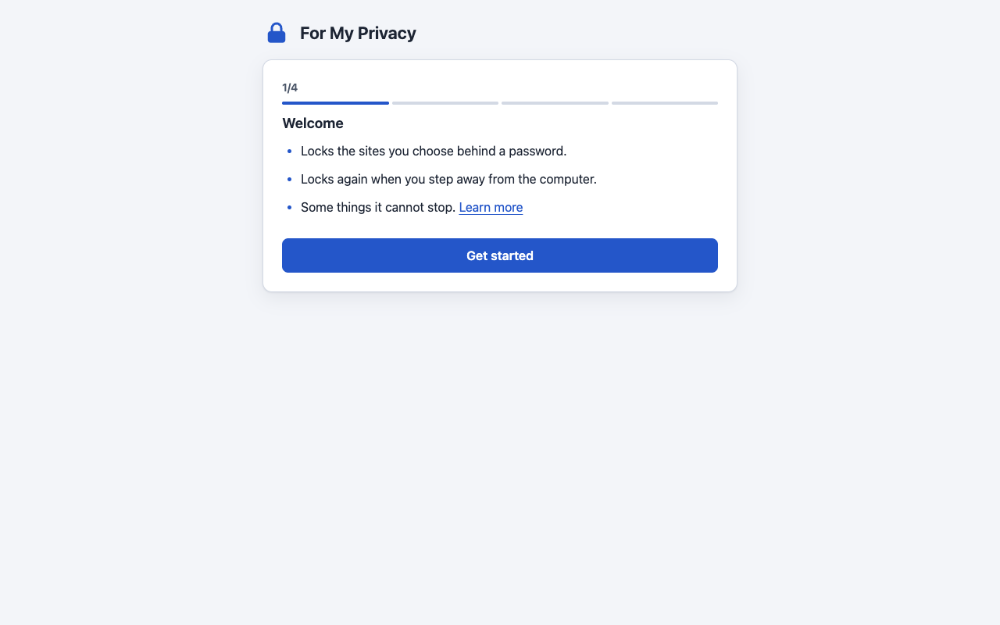
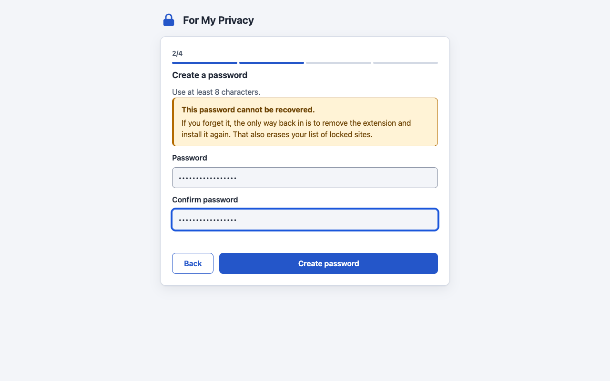
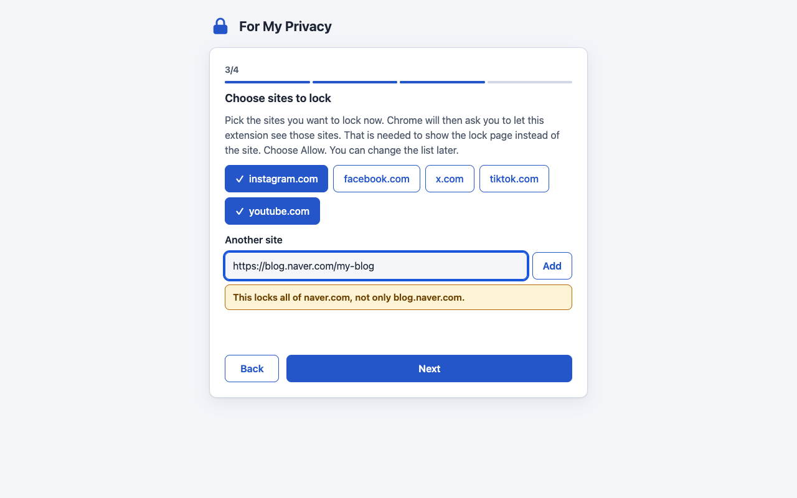
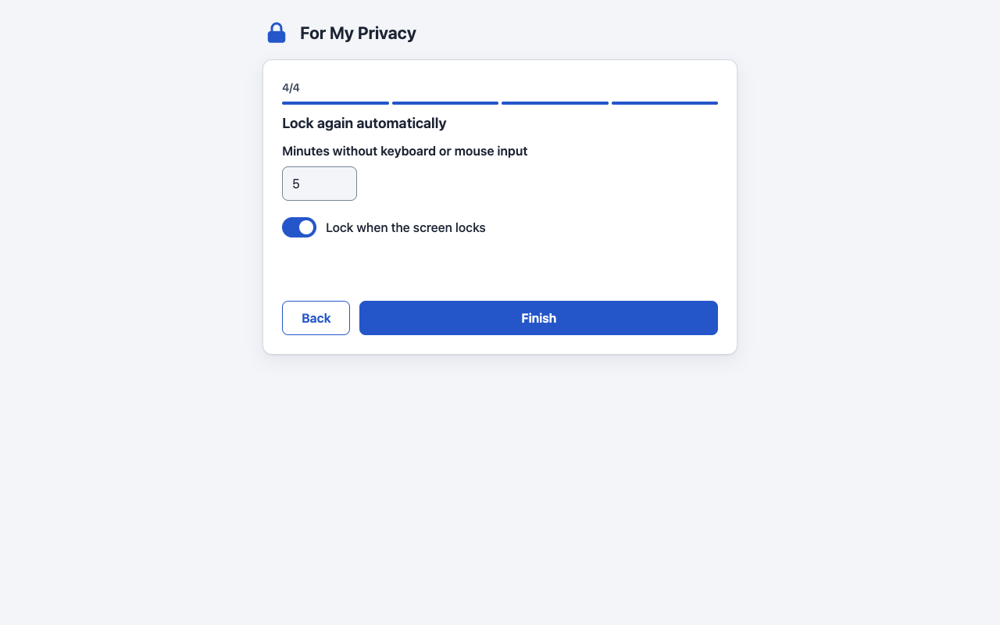
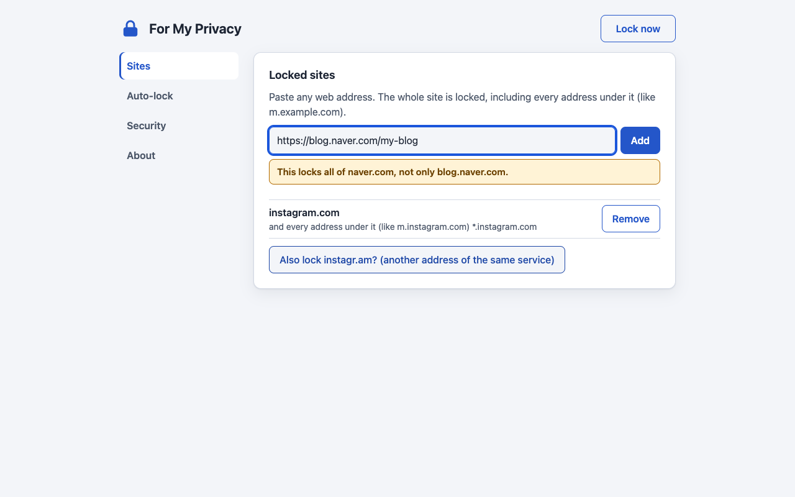
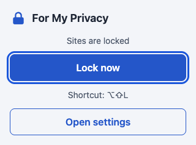
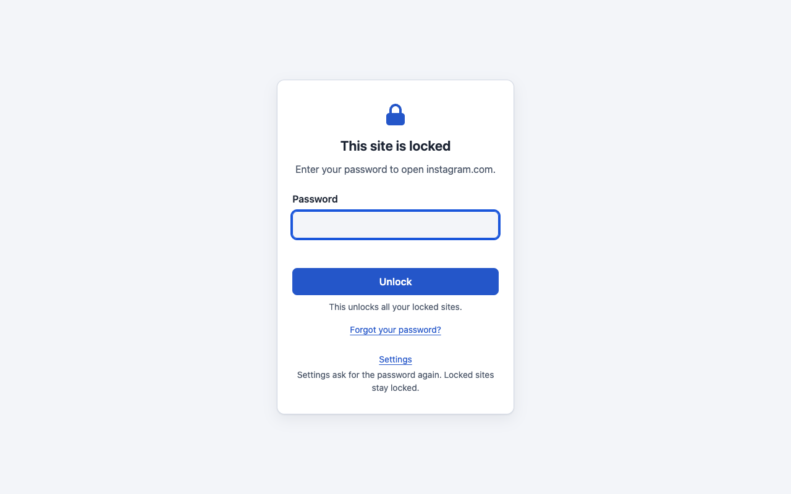
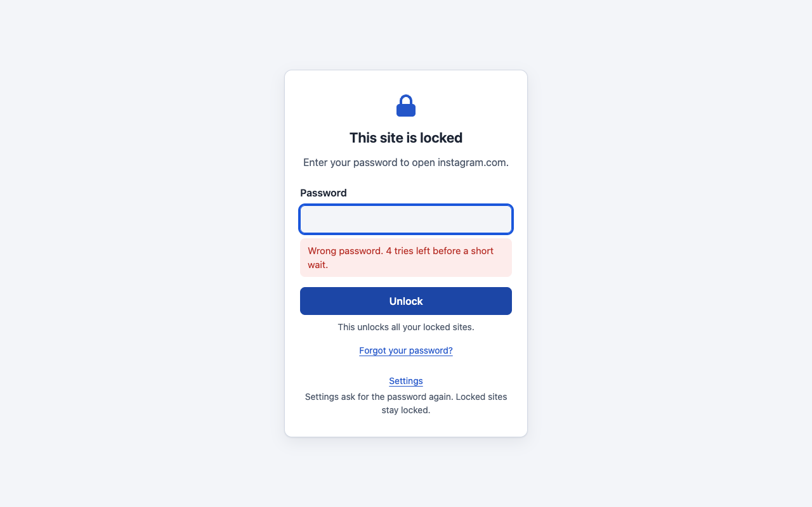
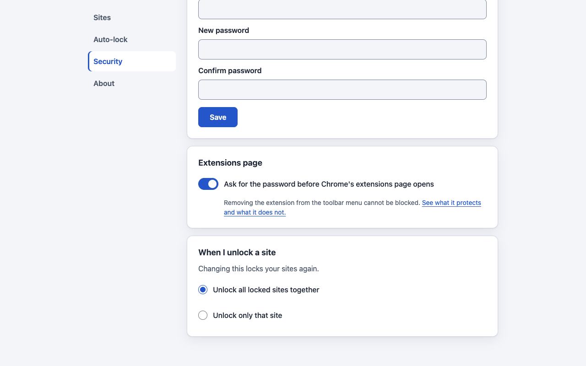

# For My Privacy: User guide

**English** · [한국어](usage.ko.md) · [日本語](usage.ja.md)

> **Status: in development, version 0.1.0 draft.** There is no release yet and the extension is not on the Chrome Web Store. For now you build it from source (see [Install](#install)). This guide describes what the code in this repository does today.

Back to the [README](../README.md).

## Contents

- [What it does](#what-it-does)
- [Install](#install)
- [First run](#first-run)
- [Adding and removing sites](#adding-and-removing-sites)
- [Locking](#locking)
- [Unlocking](#unlocking)
- [Settings tour](#settings-tour)
- [Forgot the password, or removing the extension](#forgot-the-password-or-removing-the-extension)
- [What it can and cannot protect](#what-it-can-and-cannot-protect)
- [FAQ and troubleshooting](#faq-and-troubleshooting)

## What it does

- It puts a password on the websites you choose. A locked site shows a lock screen instead of the page until you type the password.
- It locks again by itself when you step away, and you can lock everything at once with one click or one key.
- It is made for one situation: you leave a shared or office computer for a moment, and someone could sit down at your unlocked, logged-in Chrome.

Everything stays on your computer. There is no account, no network request and no analytics.

## Install

For now there are no download files. You build the extension once on your computer and load the built folder into Chrome. It takes about five minutes.

### Install from source

You need [Git](https://git-scm.com/) and [Node.js](https://nodejs.org/) 22 or newer. Chrome must be version 120 or newer.

1. Open a terminal. On macOS this is the Terminal app. On Windows use PowerShell or Command Prompt.
2. Get the code and build it:

   ```sh
   git clone https://github.com/xcryptp/for-my-privacy.git
   cd for-my-privacy
   npm ci
   npm run build
   ```

   The build is ready when the last command ends without an error. It creates the folder `.output/chrome-mv3` inside `for-my-privacy`.
3. In Chrome, open `chrome://extensions`.
4. Turn on **Developer mode** (top right).
5. Click **Load unpacked** and choose the folder `.output/chrome-mv3` (the folder that contains `manifest.json`).
6. The settings page opens by itself and starts the first-run setup (see [First run](#first-run)).

Notes:

- **macOS:** Finder hides folders whose names start with a dot. In the folder chooser, press Command+Shift+. (period) to show `.output`.
- **Windows:** `.output` is shown normally.
- **Keep the folder where it is.** Chrome reads the extension from it every time it starts. If you move or delete it, Chrome can no longer load the extension, and loading it again from the new place may start the first-run setup over.
- **A notice at start.** Chrome shows a notice about developer-mode extensions when it starts. That is normal for extensions loaded this way.
- **Updating later:** get the new code, run `npm ci` and `npm run build` again, then click the reload icon on the extension's card at `chrome://extensions`.

### Chrome Web Store

Not yet. When the extension is listed, this guide will say so here and you will be able to install it with one click.

### What Chrome's permission messages mean

Wherever Chrome shows the extension's permissions (the extension's details page, and later the store page), you will see two warnings:

- **Block content on any page.** This is the `declarativeNetRequest` permission. The extension needs it to block locked sites even when site access has been withdrawn. It only acts on the sites you add.
- **Read your browsing history.** This is shared by the `tabs` and `webNavigation` permissions. They let the extension find tabs and frames that show a locked site. It compares their addresses with your list of locked sites and sends nothing anywhere.

The other permissions (`storage`, `idle`, `browsingData`) have no warning in Chrome.

**Site access** is separate and optional. When you add a site, Chrome asks you to allow this extension to access that site, one site at a time. Choose Allow: without it the extension cannot show the lock screen in place of the site.

## First run

When you load the extension for the first time, the settings page opens with a four-step setup. A counter such as 1/4 and a progress bar at the top show where you are.

### Step 1: Welcome

The page says what the extension does in three lines and has a **Learn more** link to what it cannot stop. Click **Get started**.



### Step 2: Create a password

Type a password of at least 8 characters, type it again under **Confirm password**, and click **Create password**.



Read the warning on this page: **this password cannot be recovered.** If you forget it, the only way back in is to remove the extension and install it again, which also erases your list of locked sites. Choose a password you will remember, and keep it somewhere safe.

If the two entries differ, the page says "The passwords do not match." If the password is too short, it says "Use at least 8 characters."

### Step 3: Choose sites to lock

Tap the sites you want to lock now: instagram.com, facebook.com, x.com, tiktok.com or youtube.com. A tapped site is marked as chosen. To lock another site, paste any web address under **Another site** and click **Add**. Under the box a line says what will be locked. You can also type the address and click **Next** without clicking **Add**.



Click **Next**. If you chose nothing, the button says **Skip** and you can add sites later. Chrome then asks to allow access to the chosen sites. Choose Allow. If you do not allow it, the page says "Chrome did not allow access to this site, so it was not added." and stays on this step.

### Step 4: Lock again automatically

Choose how long the computer may sit without keyboard or mouse input before everything locks again (1 to 60 minutes, 5 by default). The switch **Lock when the screen locks** is on by default. Click **Finish**.



A tip at the top of the settings then says that your sites are locked and names your lock shortcut key, or tells you where to set one. Your chosen sites are locked right away. The password you just made does not open them: open one in a new tab and you will see the lock screen.

> If you reload the page between steps 2 and 4, the setup picks up where it was and offers **Skip setup and go to settings**.

## Adding and removing sites

Open the settings (see [Settings tour](#settings-tour)). They open on **Sites**.



**Adding.** Under **Locked sites**, type a site or paste any web address into the box and click **Add**.

- **Any address works.** The extension reduces it to the whole site. A Naver blog link locks all of `naver.com`, and a Gmail link locks all of `google.com`, Search included. You cannot lock one blog or one part of a site on its own.
- **Every address under it is locked,** at any depth: `instagram.com`, `www.instagram.com`, `help.instagram.com` and `a.b.instagram.com`. Look-alike names such as `notinstagram.com` are left alone. Addresses on shared hosts such as `user.github.io` count as their own site.
- **The preview line** under the box tells you what a click on **Add** will lock before you click. For `instagram.com` it says "Will lock instagram.com and every address under it (like m.instagram.com)." For a blog link it says "This locks all of naver.com, not only blog.naver.com." If the text is not a site address, it says "Enter a site address such as example.com."
- **Suggestions.** For some services the list offers a button such as "Also lock instagr.am? (another address of the same service)". Click it to add that address too.
- **Site access.** Chrome asks to allow access to the site you add. Choose Allow. If you do not, the page says "Chrome did not allow access to this site, so it was not added."

**Removing.** Click **Remove** on the site's row. The site is no longer locked at once. The extension also gives back the site access it had asked for.

Settings are saved as soon as you change them. A short "Saved." message confirms it.

## Locking

There are three ways to lock by hand, and four automatic ones. A lock never asks for the password. Locking also locks the settings.

### By hand

- **The toolbar popup.** Click the extension's icon in the Chrome toolbar and click **Lock now**. The popup says "Locked" and closes. Once the setup is done, a line under the title also says "Sites are locked" or "Some sites are unlocked". If you cannot see the icon, click the puzzle-piece icon in the toolbar and pin For My Privacy first.

  

- **The keyboard shortcut.** Press Alt+Shift+L (Option+Shift+L on a Mac). If another extension already uses that key, Chrome may leave the shortcut unset. The popup shows the key that is set, under the buttons. To set or change it, open `chrome://extensions/shortcuts` and choose a key for **For My Privacy** under **Lock now**.
- **In the settings.** The **Lock now** button at the top of the settings page does the same.

### Automatically

- **Idle time.** After the number of minutes you chose with no keyboard or mouse input. The timer counts input on the whole computer, not only in Chrome.
- **Screen lock.** When the computer's screen locks, if **Lock when the screen locks** is on. If you switch it off, a screen lock alone does not lock the sites, but the idle time still counts while the screen is locked.
- **Closing all windows.** When the last Chrome window closes.
- **Restarting Chrome.** Chrome starts with everything locked. Lock screens that Chrome restores after a restart, or after you update the extension, still know which site they were for, so unlocking there still takes you to the site.

When the lock comes back, every open tab of a locked site is replaced by the lock screen, and the Back button does not bring the old page back. A `blob:` page or an empty `about:blank` tab that a locked site opened is locked too.

A tab that only shows a locked site inside another page (an embedded video, for example) is reloaded instead. If that tab's own "Leave site?" or form-resubmission question holds the reload back, the extension closes the tab after about 3 seconds and opens it again at the same address. Anything you typed there and had not saved is lost.

## Unlocking

Open a locked site, or click a link to one, and the lock screen appears instead of the page. It names the site, but not the page you tried to open.



Type your password and click **Unlock**. The tab goes to the site. The line under the button says what this unlock opens.

- **Wrong password.** The lock screen says how many tries are left before a wait, for example "Wrong password. 4 tries left before a short wait."

  

- **The waiting countdown.** After 5 wrong tries in a row, you have to wait before the next one. The first wait is 30 seconds, and it doubles with each further wrong try, up to 15 minutes. The page counts down, for example "Too many wrong tries. Try again in 30 s." The wait also applies to the settings and to Change password, and it is still there after you reload the page. A correct password starts the count again.
- **Unlock all together, or only that site.** In **Settings → Security**, **When I unlock a site** has two choices:
  - **Unlock all locked sites together** (the default). One unlock opens every locked site and Chrome's extensions page.
  - **Unlock only that site.** An unlock opens only the site on the lock screen and every address under it. Other locked sites stay locked. Chrome's extensions page opens only from its own lock screen.

  

  Changing this choice locks your sites again at once. The settings stay open and say "Saved. Your sites are locked again." (or just "Saved." if the extension has not confirmed the lock yet).
- **Other lock tabs.** Lock screens that replaced your site tabs when the lock came back go back to their sites by themselves once the site is open. A lock screen you reached by visiting a locked site yourself stays as it is. Reload it and it goes to the site if the site is open. In "only that site" mode, only the lock screens of the site you unlocked go back.
- **Nothing to go back to.** If the tab has nowhere to return to, the lock screen says "Unlocked. You can open your site again." (in "only that site" mode, when nothing was opened: "Nothing to open here. Open the site again.").

The unlock stays until the next lock. Unlocking a site does not open the settings (see below).

## Settings tour

Open the settings in any of these ways:

- On the lock screen, click **Settings**.
- In the toolbar popup, click **Open settings**.
- Right-click the extension's icon and choose **Options**.

The settings ask for your password first ("Settings are locked"). The password is the same one, but the settings have their own unlock, so unlocking a site does not open them and unlocking them does not open any site. A short unlock to read one site therefore does not leave your list of locked sites open for changes. Right after you create the password, the settings are open.

The settings page also hides its contents while its tab is in the background. When you come back to the tab it draws them again, and a half-typed address or password that you had not saved is gone. Saved settings are unaffected.

A menu at the side has four sections. **Lock now** is at the top whenever the settings are open.

| Section | What is there |
| --- | --- |
| **Sites** | The list of locked sites, the box to add one, suggestions, and a notice "Site access was removed" with a **Grant access** button when Chrome no longer lets the extension see a listed site |
| **Auto-lock** | **Minutes without keyboard or mouse input** (1 to 60, default 5) and the switch **Lock when the screen locks**. A number outside 1 to 60 is changed to the nearest allowed one, and the page tells you |
| **Security** | **Change password**, **Extensions page**, and **When I unlock a site** (see above) |
| **About** | The version, and links to "What it protects and what it does not", the privacy policy and the source code on GitHub |

**Change password** asks for your current password, the new one (8 characters or more) and the new one again, then **Save**. The new password cannot be recovered either.

**Extensions page.** The switch **Ask for the password before Chrome's extensions page opens** is on by default. While locked, opening `chrome://extensions` shows a lock screen titled "Chrome's extensions page is locked" instead, and after you unlock you land on the extensions page. This makes it harder to switch the extension off quietly. It does not stop someone from removing the extension from the toolbar menu. This switch is not in the `-noguard` build.

## Forgot the password, or removing the extension

A forgotten password cannot be recovered. The lock screen and the locked settings page both have a note, **Forgot your password?**, that says how to start over:

1. Click the puzzle-piece icon in the Chrome toolbar.
2. Click the three-dot menu next to For My Privacy.
3. Choose "Remove from Chrome".

This erases the password and the list of locked sites. Then load the extension again (the same `.output/chrome-mv3` folder, see [Install](#install)) and go through the [first run](#first-run) again. You can also remove the extension with the **Remove** button on its card at `chrome://extensions`.

Anyone who uses Chrome on your computer can do this too. See the next section.

## What it can and cannot protect

It is built to stop a person who sits down at your unlocked Chrome while you are away from opening the sites you locked. It does not stop someone who controls your computer or knows Chrome's developer tools. Removing the extension from the toolbar menu, starting Chrome with extensions off, and Chrome's page titles in history are not covered either.

The full list, and what helps for each, is in the README: [What it protects and what it does not](../README.md#what-it-protects-and-what-it-does-not).

## FAQ and troubleshooting

**A site opened without the lock screen.**
- Check that it is listed under **Settings → Sites**. A different address of the same service is a different site: `youtu.be` is not `youtube.com` unless it is also listed.
- Check that the site is locked right now. After an unlock the site stays open until the next lock.
- Check for the notice "Site access was removed" on **Sites**. If it is there, click **Grant access**.
- Incognito and Guest windows are not covered, and the extension is off there by default.

**I see Chrome's blocked page before the lock screen.** Site access was withdrawn (for example from the toolbar menu). The site is still blocked, but Chrome can show its own page for a moment first. Open **Settings → Sites** and click **Grant access**.

**The keyboard shortcut does nothing.** Chrome may have left it unset because another extension uses the same keys. Open `chrome://extensions/shortcuts` and choose a key for **Lock now** under For My Privacy. The popup shows the key that is set.

**I cannot find the extension's icon.** Click the puzzle-piece icon in the Chrome toolbar and pin For My Privacy.

**The popup says "Finish the setup in Settings first."** No password exists yet. Open the settings and finish the first-run setup.

**A site locked again by itself.** Something locked it: idle time, a screen lock, closing all windows, restarting Chrome, or **Lock now**. If it happens too often, raise the minutes under **Settings → Auto-lock**.

**The unlock button is greyed out with a countdown.** There were 5 wrong tries. Wait for the countdown to end; it cannot be skipped. The same wait applies to the settings and Change password.

**Chrome says the extension cannot be loaded after I moved or deleted the folder.** Build again if needed and load the folder with **Load unpacked** again. Chrome may treat it as a new extension, so the first-run setup can start again.

**Chrome shows a notice about developer-mode extensions at start.** That is normal for extensions loaded unpacked.
